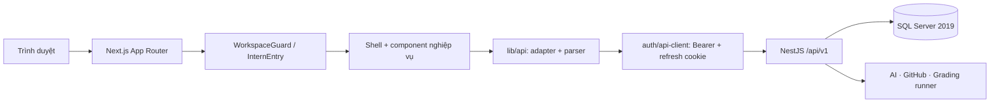

<div align="center">

# V-Intern Frontend

**Sổ tay hành trình thực tập** — giao diện Next.js cho sinh viên, giảng viên và quản trị viên.

[](https://github.com/vanhoi04082006-pixel/V-Intern-FE/actions/workflows/ci.yml)
[](https://github.com/vanhoi04082006-pixel/V-Intern-FE/actions/workflows/phase7-fullstack.yml)


[Quick start](#quick-start) · [Tài liệu](docs/README.md) · [Kiến trúc](docs/ARCHITECTURE.md) · [Route](docs/ROUTE-MAP.md) · [API contract](docs/API-CONTRACTS.md)

</div>

---

## V-Intern là gì?

V-Intern mô phỏng một kỳ thực tập phần mềm có đầy đủ vòng đời: tuyển chọn, xếp lớp, giao dự án, làm việc theo Sprint, nộp bài qua GitHub, đánh giá, KPI, lương ảo và chứng nhận. Frontend là lớp trải nghiệm cho ba vai trò; **mọi quyết định nghiệp vụ, phân quyền và dữ liệu chuẩn đều nằm ở NestJS API**.

| Vai trò | Trải nghiệm chính |
|---|---|
| **Sinh viên** | Ứng tuyển, phỏng vấn, chờ phân công, nhận task, nộp bài, hỏi AI Mentor, xem đánh giá/KPI/chứng nhận |
| **Giảng viên** | Mở phiên, duyệt kế hoạch, quản lý Sprint/task, chấm bài, theo dõi hiệu suất, xuất báo cáo |
| **Quản trị viên** | Quản lý người dùng, nghề nghiệp, câu hỏi, mẫu dự án, kho tri thức, cấu hình AI/GitHub, KPI và chứng nhận |

Thiết kế hiện tại là **Journey Notebook**: nền giấy kem, nét mực, băng dính washi, con dấu mộc và typography viết tay có kiểm soát. Chi tiết token và quy tắc sử dụng nằm trong [UI System](docs/UI-SYSTEM.md).

## Kiến trúc trong 30 giây



- **Không có backend nghiệp vụ trong Next.js.** Route chỉ chọn layout/component; dữ liệu đi qua `lib/api` tới NestJS.
- **Hai shell, một hệ thiết kế.** `InternShell` cho sinh viên, `ProductShell` cho giảng viên/admin; cả hai dùng chung token notebook.
- **Guard theo vòng đời.** Sinh viên đã đậu nhưng chưa có assignment chỉ vào được màn chờ, thông báo, hồ sơ và GitHub. API vẫn kiểm tra quyền lần cuối.
- **Adapter kiểm tra dữ liệu thật.** Response sai schema bị từ chối thay vì render như dữ liệu hợp lệ.
- **Access token nằm trong bộ nhớ.** Refresh cookie là HttpOnly; không lưu token vào `localStorage`, URL hay BroadcastChannel.

## Công nghệ

| Lớp | Công nghệ |
|---|---|
| Framework | Next.js 16.4.2 (App Router), React 19.2.3 |
| Ngôn ngữ | TypeScript 5, strict mode |
| Giao diện | Tailwind CSS 4, CSS variables, Framer Motion, bộ icon notebook vẽ tay |
| Dữ liệu | Fetch API, adapter/parser thủ công, `useResource` cho abort/error/reload |
| Kiểm thử | Vitest + Testing Library (JSDOM), Playwright cho browser harness |
| Chất lượng | ESLint, `tsc --noEmit`, `npm audit --omit=dev`, Next production build |

## Quick start

### Yêu cầu

- Node.js **22+** và npm
- NestJS API đang chạy (mặc định `http://localhost:8080/api/v1`)
- SQL Server 2019 đã được API kết nối thành công

### Chạy local

```powershell
# Tại thư mục gốc repository Frontend
& .\scripts\Use-ProjectStorage.ps1   # đưa cache/temp vào .runtime của dự án
Copy-Item .env.example .env          # chỉ khi chưa có .env
npm ci
npm run dev
```

Mở **http://localhost:3001**. Kiểm tra API trước khi debug giao diện:

```powershell
Invoke-RestMethod http://localhost:8080/api/v1/health
```

`NEXT_PUBLIC_API_BASE_URL` phải chứa đầy đủ tiền tố `/api/v1`. Biến `NEXT_PUBLIC_*` được nhúng vào bundle lúc **build**, không phải lúc restart.

### Chạy bản production trên máy bàn giao

```powershell
& .\scripts\Use-ProjectStorage.ps1
npm run build
& ..\manual-runtime\restart-owned-apps.ps1 -Frontend
```

Không chạy hai process dev dùng chung thư mục `.next`. Nếu cổng 3001 đang bận, kiểm tra process sở hữu trước khi dừng.

## Lệnh thường dùng

| Lệnh | Tác dụng |
|---|---|
| `npm run dev` | Next dev server tại cổng 3001 |
| `npm run build` | Build production |
| `npm start` | Chạy bản build tại cổng 3001 |
| `npm run lint` | ESLint toàn repo |
| `npm run typecheck` | `tsc --noEmit` |
| `npm test` | Vitest một lượt |
| `npm run test:watch` | Vitest watch mode |

Các harness trình duyệt/live nằm trong `scripts/*.mjs` và được gọi bởi workflow full-stack, không phải script npm mặc định. Xem [Testing](docs/TESTING.md).

## Cấu trúc repository

```text
src/
├─ app/                  # 80 route: public 8 · admin 31 · instructor 18 · intern 23
├─ components/
│  ├─ auth/              # đăng nhập, guard, quyền hiển thị
│  ├─ intern/            # shell, dashboard, onboarding, bài làm
│  ├─ instructor/        # adapter và thành phần giảng viên
│  ├─ admin/             # console quản trị
│  ├─ product/           # luồng nghiệp vụ dùng chung
│  ├─ sessions/          # phiên, kế hoạch, Sprint, báo cáo
│  ├─ workspace/         # notebook tokens, shell, chart, primitives
│  └─ v-intern/          # landing page và icon notebook
├─ lib/
│  ├─ api/               # adapter theo domain + parser + useResource
│  └─ auth/              # session, refresh, permission, cookie coordination
├─ styles/               # token và CSS toàn cục
└─ test/                 # setup Vitest
docs/                    # tài liệu kỹ thuật và lịch sử
scripts/                 # harness QA/live, kiểm tra hợp đồng
```

## Kiểm thử và chất lượng

```powershell
& .\scripts\Use-ProjectStorage.ps1
npm run lint
npm run typecheck
npm test
npm run build
git diff --check
```

CI `verify` chạy lint → typecheck → test → audit dependency production → build trên mọi PR vào `main`. Workflow `sql2019` dựng SQL Server 2019, checkout đúng BE contract SHA và chạy bộ kiểm tra full-stack. **Không merge khi một trong hai gate đỏ.**

Trạng thái gần nhất (02/11/2026): **117 file test / 672 test đạt**; lint, typecheck và build đạt trên `main`.

## Tài liệu

| Bắt đầu ở đâu | Nội dung |
|---|---|
| [Mục lục tài liệu](docs/README.md) | Toàn bộ tài liệu, chia theo nhu cầu đọc |
| [Getting started](docs/GETTING-STARTED.md) | Cài đặt, cấu hình, chạy, xác nhận môi trường |
| [Kiến trúc](docs/ARCHITECTURE.md) | Routing, shell, auth, data layer, lifecycle |
| [Bản đồ route](docs/ROUTE-MAP.md) | 80 route và component tương ứng |
| [API contract](docs/API-CONTRACTS.md) | Hợp đồng FE ↔ BE theo domain |
| [UI System](docs/UI-SYSTEM.md) | Token, utility, icon, component, accessibility |
| [Kiểm thử](docs/TESTING.md) | Unit, browser, live harness và CI |
| [Bảo mật](docs/SECURITY.md) | Phiên, phân quyền, XSS, secret, audit |
| [Đóng góp](docs/CONTRIBUTING.md) | Nhánh, commit, PR, quality gate |
| [Bàn giao](docs/HANDOVER.md) | Checklist tiếp nhận và các giới hạn đã biết |
| [Demo](docs/DEMO.md) | Kịch bản demo trước hội đồng |
| [Kiểm chứng](docs/VERIFICATION.md) | Bằng chứng và phạm vi đã kiểm |

### Tài liệu nghiệp vụ

[Thư viện nghề nghiệp](docs/CAREER-ROLES.md) · [CV và lịch phỏng vấn](docs/CV-AND-INTERVIEW-SCHEDULING.md) · [Phòng chờ & hẹn lại](docs/SCHEDULED-INTERVIEWS.md) · [Khôi phục mật khẩu tạm](docs/TEMPORARY-CREDENTIAL-RECOVERY.md) · [Thư viện dự án nhỏ](docs/MINI-PROJECTS.md) · [Kho tri thức](docs/KNOWLEDGE-LIBRARY.md) · [Thời hạn & điểm phạt](docs/PARTICIPATION.md) · [Thay thành viên](docs/REPLACEMENT.md) · [GitHub invitations](docs/GITHUB-INVITATIONS.md) · [Khôi phục quyền repo](docs/REPOSITORY-ACCESS-RECOVERY.md)

## Quy ước quan trọng

- **API là nguồn sự thật.** Không suy đoán quyền, điểm, trạng thái hay lifecycle từ dữ liệu đã tải một phần.
- **Không dữ liệu giả để lấp UI.** Loading, empty, lỗi và “chưa đo được” phải là các trạng thái khác nhau.
- **Giữ accessibility.** Mọi hành động có accessible name; modal có focus trap, Escape và trả focus; tôn trọng `prefers-reduced-motion`.
- **Không hạ gate.** Không skip/xóa test, không `@ts-ignore`, không `eslint-disable` để làm xanh.
- **Không commit secret.** `.env`, token, mật khẩu và `manual-runtime/private` chỉ tồn tại trên máy.
- **Tài nguyên trong workspace.** Dependency, cache, log và bằng chứng nằm dưới `E:\Projects\V-INTERN\.runtime`.

## Trạng thái

| Hạng mục | Giá trị |
|---|---|
| Nhánh chính | `main` |
| Commit | `063c3d5` |
| Route | 80 page source |
| Test | 672 Vitest test |
| API | NestJS `/api/v1`, Swagger `/api/docs` |
| Thiết kế | Journey Notebook, dark mode “chalkboard night” |

> Đây là repository nội bộ. Thông tin đăng nhập, khóa và cấu hình môi trường được bàn giao qua kênh riêng, không nằm trong README.
