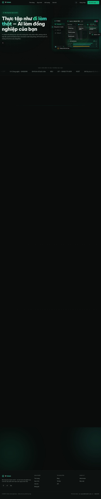
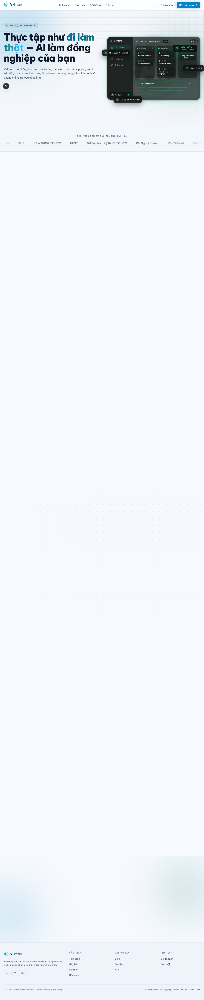
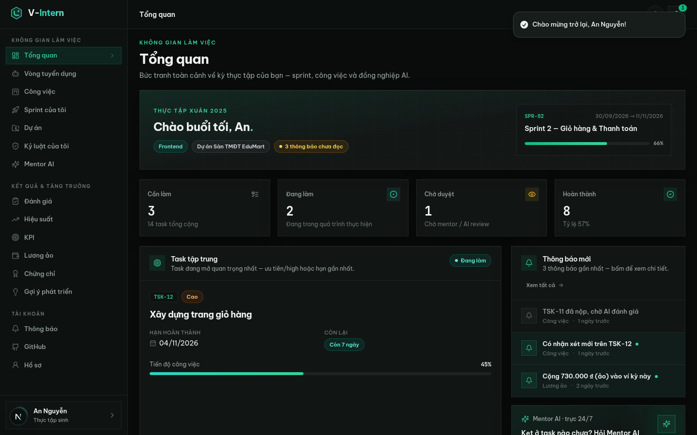

# V-Intern Frontend — Redesign "Emerald Noir + Sky White"

> **Tái thiết kế toàn bộ UI/UX** của nền tảng [V-Intern-FE](https://github.com/vanhoi04082006-pixel/V-Intern-FE):
> giữ nguyên **100% chức năng** của bản gốc (đã đối chiếu với `main` — nơi chứa toàn bộ code của mọi nhánh
> `codex/g3→g7`, `notebook-workspace`, `ui-ux-overhaul`...), thay mới hoàn toàn giao diện + **chế độ sáng/tối**.
> Backend demo mock tích hợp ngay trong app nên **chạy được độc lập, không cần API ngoài**.

| Landing — Dark "Emerald Noir" | Landing — Light "Sky White" |
|---|---|
|  |  |

| Không gian làm việc Intern (dark) | Cổng nộp CV công khai `#/apply` |
|---|---|
|  | Nộp CV → Agent phân tích → đặt lịch phỏng vấn — không cần tài khoản |

## Điểm nhấn của bản redesign

| Hạng mục | Trước (main) | Sau (branch này) |
|---|---|---|
| Chủ đề | Aurora Glass sáng/tối | **2 theme**: Dark "Emerald Noir" (brand `#10B981`) + Light "Sky White" (trắng + xanh dương `#0284C7`) — toggle ở mọi nơi |
| Kiến trúc route | 78 route Next.js phụ thuộc NestJS `:8080` | **SPA 1 route + hash-router** (`#/intern/work`, `#/admin/knowledge`…) |
| Backend | Bắt buộc NestJS API | **Mock API ~140 endpoints** trong Next.js (in-memory, seed đầy đủ 3 vai trò) + **LLM thật** cho Mentor AI |
| Landing | Trang chủ tĩnh | 9 khối: hero mockup dashboard động, trust marquee, bento features, AI showcase, roles, FAQ accordion |
| Auth | Form cơ bản | Split-screen 2 cột, strength meter, checklist mật khẩu live, 4 chip quick-fill demo |

## Chức năng đầy đủ (đối chiếu từng route bản gốc)

**Cổng công khai** — `#/apply` nộp CV công khai (đợt tuyển → email xác minh → Agent phân tích CV với confidence
+ facts/missing → đặt/dời lịch phỏng vấn) · `#/verify` tra cứu chứng chỉ · `#/github/invitation` nhận lời mời
GitHub của phiên (repo, thành viên, reconcile, activity) · `#/change-password` đổi mật khẩu.

**Sinh viên** — onboarding 4 bước + **phỏng vấn AI 6 câu** (chấm điểm heuristic theo vai trò) · dashboard ·
công việc (list + **kanban kéo-thả**) · task detail (nộp bài + **AI Code Review 6 tiêu chí** + bình luận +
lịch sử) · sprint · dự án · **Mentor AI chat (LLM thật)** · đánh giá · hiệu suất · KPI · lương ảo · chứng chỉ ·
gợi ý phát triển · **kỷ luật của tôi** (vi phạm, điểm phạt, lịch sử nhận bàn giao).

**Giảng viên** — **đợt tuyển dụng** (khung giờ phỏng vấn theo nghề + hồ sơ CV 9 trạng thái + phân tích Agent +
dời lịch/khôi phục tài khoản/hủy) · dự án mẫu · buổi thực tập (5 tab + **tab "Khởi tạo" 3 bước**: dự án → đội
hình → Kế hoạch AI → khởi động) · sprint workspace (duyệt bài slider 6 tiêu chí) · **kỷ luật phiên** (chính sách
trễ hạn, miễn trừ/hoàn tác/gia hạn, **wizard thay thành viên 3 bước** với Agent đối chiếu → preview → approve,
quyền GitHub sau bàn giao) · **chia sẻ dữ liệu phiên** · đánh giá · hiệu suất · báo cáo + CSV.

**Quản trị viên** — dashboard · người dùng v2 (username, multi-role, metrics, trạng thái) · **thư viện nghề
nghiệp** (kỹ năng + trọng số, versioned, xuất bản/lưu trữ, lịch sử bản) · ngân hàng câu hỏi · **kho tri thức
Agent** (7 loại tài liệu, editor 4 section neo, nguồn, kiểm tra xuất bản, khôi phục lịch sử, import dry-run) ·
dự án mẫu · buổi thực tập · nhiệm vụ (CRUD) · sprint · hiệu suất (top-10 + CSV) · báo cáo · **hàng đợi email**
(preview HTML/text, gửi lại có kiểm soát + cooldown) · **nhóm người dùng** · **vai trò & quyền** · **danh mục
dùng chung** · cấu hình AI · dịch vụ · cài đặt · hoạt động · kiểm toán.

## Kiến trúc

```
src/
├── app/                    # 1 route duy nhất (/) + API catch-all /api/v1/[...path]
├── components/
│   ├── app/                # AppShell (sidebar theo role + ThemeToggle), hash-router registries
│   ├── auth/               # Login / Register / Forgot / Verify / ChangePassword (split-screen)
│   ├── landing/            # 9 khối landing page
│   ├── shared/             # Kanban DnD, Chat, ThemeProvider/Toggle, ConfirmDialog, Toolbar…
│   ├── ui/                 # shadcn/ui đầy đủ (New York style)
│   └── views/              # public/ · intern/ · instructor/ · admin/ · shared/
└── lib/
    ├── client/             # hash-router (hydration-safe), session, http, api.ts + api-org.ts (~2300 dòng)
    └── server/             # mock backend: store + seed + 20 nhóm handlers (~140 endpoints)
```

- **Design system**: [`docs/DESIGN.md`](docs/DESIGN.md) — token 2 theme (`.dark` / `:root:not(.dark)`)
- **Hợp đồng API mock**: [`docs/API.md`](docs/API.md)

## Chạy local

```bash
npm install        # hoặc bun install / pnpm install
npm run dev        # http://localhost:3000
npm run lint       # eslint — 0 lỗi
npm run typecheck  # tsc — sạch
```

## Tài khoản demo (password: `demo1234`)

| Vai trò | Email | Trải nghiệm |
|---|---|---|
| Thực tập sinh (data đầy đủ) | `an.nguyen@student.edu.vn` | Sprint, kanban, AI Code Review, KPI 81.9, lương ảo 6.480.000₫, chứng chỉ, Mentor AI, kỷ luật TSK-12 |
| Thực tập sinh mới | `binh.tran@student.edu.vn` | Onboarding → chọn vai trò → **phỏng vấn AI 6 câu** → kết quả chấm điểm |
| Giảng viên | `hong.le@gv.edu.vn` | Đợt tuyển RR-2025-03, kỷ luật phiên + wizard thay người, setup wizard 3 bước, duyệt bài |
| Quản trị viên | `admin@vintern.edu.vn` | Toàn bộ 20 trang admin: nghề nghiệp, kho tri thức, hàng đợi email, nhóm/quyền/danh mục… |

## Ghi chú

- Dữ liệu là **in-memory store** (globalThis): reset seed mỗi lần restart server — không cần seed thủ công.
- Mentor AI gọi `z-ai-web-dev-sdk` server-side; nếu cấu hình AI không khả dụng thì dùng fallback nội dung mẫu.
- Hash-router hydration-safe: reload trực tiếp URL hash bất kỳ (vd `#/admin/knowledge`) không lỗi hydration
  và đăng nhập xong quay về đúng trang đó.
- Bản redesign thay toàn bộ `src/` cũ — tài liệu bàn giao của bản trước vẫn xem được ở branch `main`.

## License

Dự án giáo dục — demo cho mục đích học tập.
