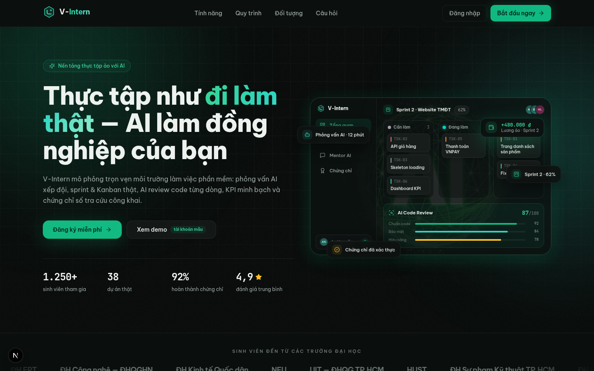
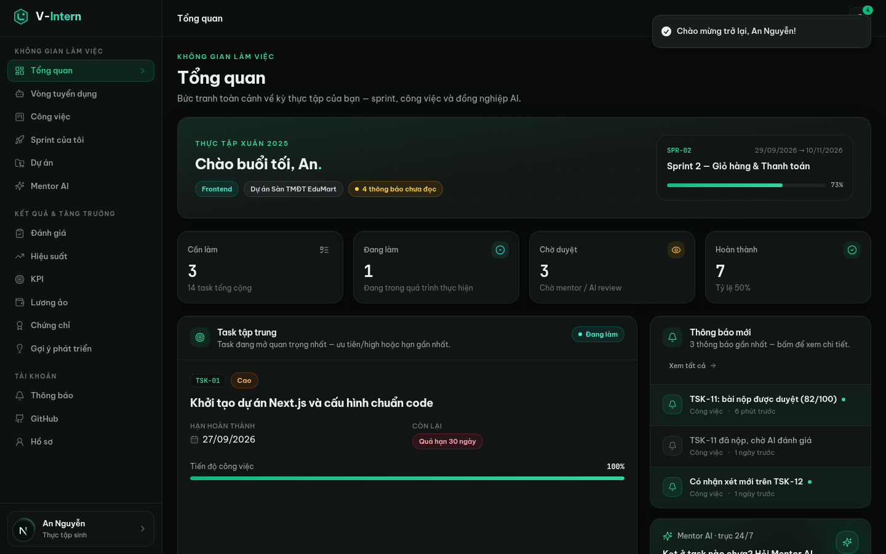

# V-Intern Frontend — Redesign "Emerald Noir"

> **Tái thiết kế toàn bộ UI/UX** của nền tảng [V-Intern-FE](https://github.com/vanhoi04082006-pixel/V-Intern-FE):
> giữ nguyên toàn bộ chức năng, thay mới 100% giao diện — chủ đề dark **"Emerald Noir"**, hiệu ứng motion
> tinh tế, bố cục hiện đại. Backend demo mock tích hợp ngay trong app nên **chạy được độc lập, không cần API ngoài**.

| Landing page | Không gian làm việc (Intern) |
|---|---|
|  |  |

## Điểm nhấn của bản redesign

| Hạng mục | Trước (main) | Sau (branch này) |
|---|---|---|
| Chủ đề | Aurora Glass ( sáng/tối ) | **Emerald Noir** — dark-only, nền gần đen ánh lục, brand `#10B981` |
| Kiến trúc route | 78 route Next.js phụ thuộc NestJS `:8080` | **SPA 1 route + hash-router** (`#/intern`, `#/admin/users`…) |
| Backend | Bắt buộc NestJS API | **Mock API ~70 endpoints** ngay trong Next.js (in-memory, seed đầy đủ) + **LLM thật** cho Mentor AI |
| Landing | Trang chủ tĩnh | 9 khối: hero mockup dashboard động, trust marquee, bento features, AI showcase, roles, FAQ accordion |
| Auth | Form cơ bản | Split-screen 2 cột, strength meter, checklist điều kiện mật khẩu live, 4 chip quick-fill demo |
|Dashboard 3 vai trò | Bảng biểu đơn giản | MetricCard động, countdown, sparkline, kanban kéo-thả (dnd-kit), chat AI, ring score SVG |

## Kiến trúc

```
src/
├── app/                    # 1 route duy nhất (/) + API catch-all /api/v1/[...path]
├── components/
│   ├── app/                # AppShell (sidebar theo role), hash-router registries
│   ├── auth/               # Login / Register / Forgot / Verify (split-screen)
│   ├── landing/            # 9 khối landing page
│   ├── shared/             # Kanban, Chat, ConfirmDialog, Toolbar, Counters…
│   ├── ui/                 # shadcn/ui đầy đủ (New York style)
│   └── views/              # intern/ · instructor/ · admin/ · shared/
└── lib/
    ├── client/             # hash-router, session, http client, typed API (~1500 dòng)
    └── server/             # mock backend: store + seed + ~15 nhóm handlers
```

- **Design system**: xem [`docs/DESIGN.md`](docs/DESIGN.md) (token màu, utilities, motion chuẩn)
- **Hợp đồng API mock**: xem [`docs/API.md`](docs/API.md)

## Chạy local

```bash
npm install        # hoặc bun install / pnpm install
npm run dev        # http://localhost:3000
```

Kiểm tra chất lượng:

```bash
npm run lint
npm run typecheck
```

## Tài khoản demo (password: `demo1234`)

| Vai trò | Email | Trải nghiệm |
|---|---|---|
| Thực tập sinh (data đầy đủ) | `an.nguyen@student.edu.vn` | Sprint, kanban, task + AI Code Review, KPI 81.9, lương ảo 6.480.000₫, chứng chỉ, Mentor AI 3 hội thoại |
| Thực tập sinh mới | `binh.tran@student.edu.vn` | Onboarding → chọn vai trò → **phỏng vấn AI 6 câu** → kết quả chấm điểm |
| Giảng viên | `hong.le@gv.edu.vn` | 2 buổi thực tập, sprint workspace, duyệt bài (slider 6 tiêu chí), Kế hoạch AI, báo cáo |
| Quản trị viên | `admin@vintern.edu.vn` | Dashboard hệ thống, users, ngân hàng câu hỏi, audit, system status |

## Chức năng giữ nguyên từ bản gốc

- **Sinh viên**: phỏng vấn AI đầu vào (chấm điểm heuristic theo vai trò), nhận nhiệm vụ theo sprint, kanban kéo-thả,
  nộp bài + **AI Code Review 6 tiêu chí**, Mentor AI chat (**LLM thật**, có fallback), KPI & lương ảo minh bạch,
  đánh giá định kỳ, chứng chỉ số + trang tra cứu công khai (`#/verify`), gợi ý phát triển, GitHub connection.
- **Giảng viên**: thư viện dự án mẫu (blueprint sprint/nhiệm vụ), quản lý buổi thực tập + thành viên,
  **Kế hoạch AI** (sinh sprint plan → xem nháp → công bố), duyệt bài nộp với slider 6 tiêu chí,
  đánh giá cuối kỳ, hiệu suất nhóm, báo cáo + export CSV.
- **Quản trị viên**: tổng quan hệ thống, quản lý users, ngân hàng câu hỏi phỏng vấn, cài đặt AI, dịch vụ,
  hoạt động & audit log.

## Ghi chú

- Dữ liệu là **in-memory store** (globalThis): reset lại seed mỗi lần restart server — không cần seed thủ công.
- Mentor AI gọi `z-ai-web-dev-sdk` ở server-side; nếu cấu hình AI không khả dụng thì tự dùng fallback nội dung mẫu.
- Bản redesign thay toàn bộ `src/` cũ — tài liệu bàn giao của bản trước vẫn xem được ở branch `main`.

## License

Dự án giáo dục — demo cho mục đích học tập.
