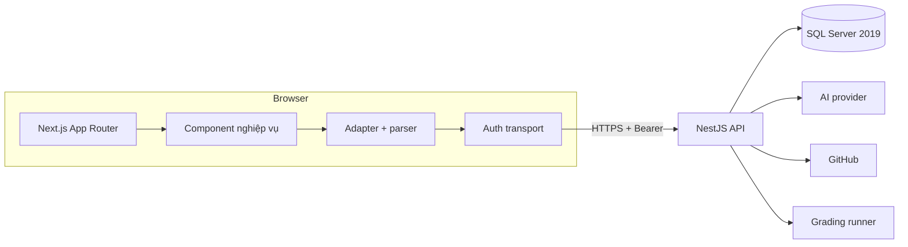
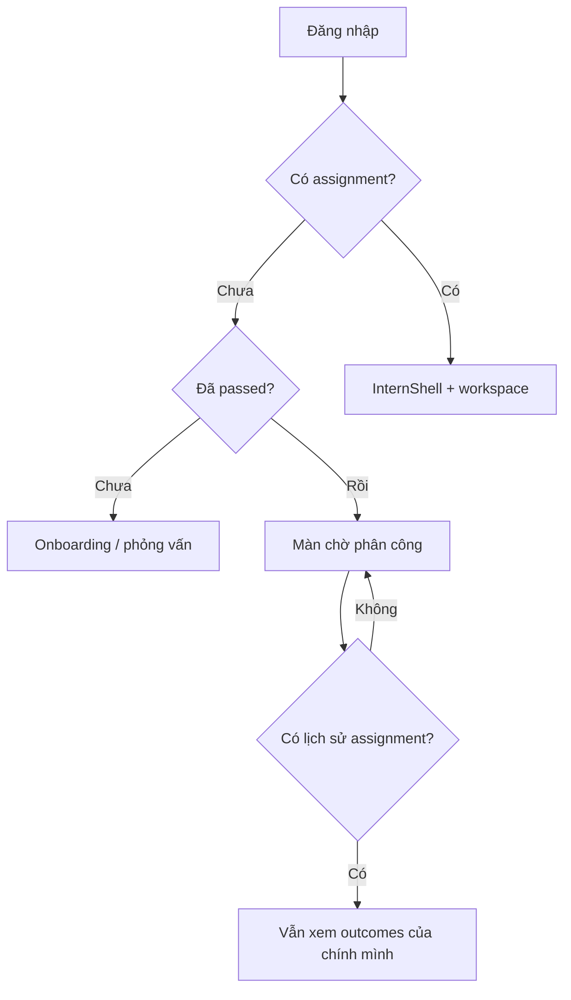
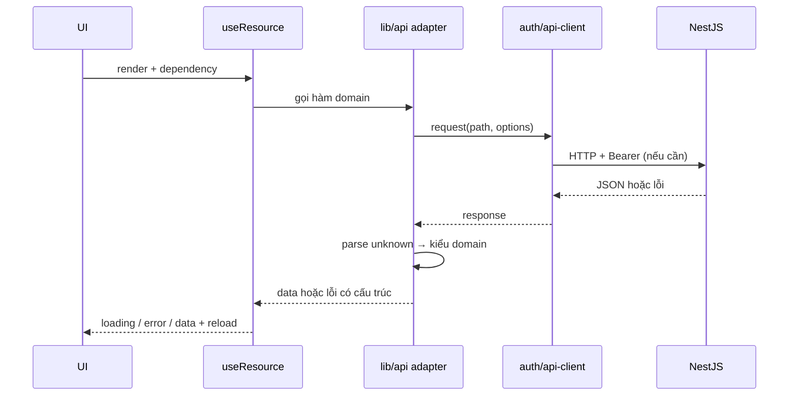
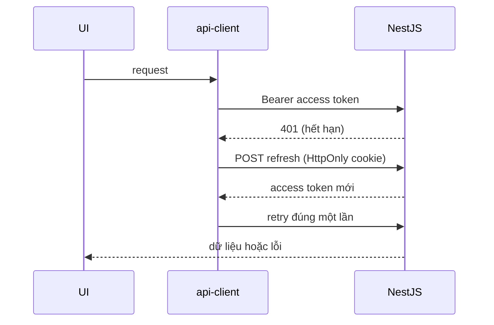

# Kiến trúc Frontend

Tài liệu này giải thích **vì sao** frontend được chia như hiện tại. Để tra URL cụ thể, dùng [ROUTE-MAP](ROUTE-MAP.md); để tra hợp đồng dữ liệu, dùng [API-CONTRACTS](API-CONTRACTS.md).

## 1. Bối cảnh hệ thống

V-Intern là hai ứng dụng độc lập:



| Ranh giới | Quyết định |
|---|---|
| Nghiệp vụ | Chỉ ở NestJS. Next.js không có database, không có route handler nghiệp vụ, không tự tính điểm |
| Xác thực | Access token trong bộ nhớ; refresh cookie HttpOnly do BE phát hành |
| Dữ liệu | Mọi response đi qua adapter/parser trước khi component dùng |
| Quyền | FE ẩn/hiện theo `Can`; BE vẫn là nơi kiểm tra cuối cùng |
| Thiết kế | Token và utility notebook dùng chung trong `src/styles` + `components/workspace` |

## 2. Routing và rendering

Frontend dùng **Next.js 16 App Router**. Mỗi thư mục dưới `src/app` là một segment; `page.tsx` là điểm vào, `layout.tsx` giữ shell/guard cho cả nhánh.

```text
src/app/
├─ (auth)/                 # login, register, forgot/change password
├─ admin/                  # 31 route quản trị
├─ instructor/             # 18 route giảng viên
├─ intern/                 # 23 route sinh viên
│  └─ onboarding/          # welcome → role → interview → result
├─ apply/                  # ứng tuyển công khai
├─ github/invitation/      # nhận lời mời repository
├─ verify/                 # xác minh chứng nhận công khai
├─ layout.tsx              # font, metadata, global CSS
├─ error.tsx               # error boundary
├─ loading.tsx             # loading toàn cục
└─ not-found.tsx           # 404
```

Nguyên tắc:

- **Layout giữ thứ ổn định.** Shell, sidebar, context và guard không dựng lại sau mỗi lần đổi tab.
- **Page mỏng.** Page chọn component và truyền params; logic nghiệp vụ nằm trong component/adapter.
- **Không lặp shell.** Route con không tự bọc thêm `ProductShell` khi layout đã có.
- **Route công khai tách biệt.** Landing, login, register, apply, verify và GitHub invitation không đi qua guard nội bộ.
- **`/instructor/classes` chỉ là redirect** tương thích sang `/instructor/projects`; không có màn quản lý lớp hay chia sẻ dữ liệu.

## 3. Guard, shell và vòng đời sinh viên

### 3.1 `WorkspaceGuard`

Bảo vệ nhánh route nội bộ:

1. Khôi phục phiên từ refresh cookie (nếu có).
2. Chờ trạng thái auth ổn định; không render nội dung khi chưa biết người dùng.
3. Kiểm tra vai trò được phép của nhánh.
4. Chuyển hướng người chưa đăng nhập về `/login`, người sai vai về landing đúng vai.

Guard chỉ là lớp điều hướng. **API vẫn kiểm tra principal, permission và ownership** cho từng request.

### 3.2 `InternEntry` và lifecycle

Sinh viên không được vào nội dung học tập chỉ vì đã đăng nhập. `InternEntry` đọc lifecycle từ API và quyết định:



- `hasAssignmentHistory` được BE trả từ assignment của chính sinh viên; FE không tự suy ra từ dữ liệu cũ.
- Người đã kết thúc placement vẫn xem được đánh giá, hiệu suất, KPI, lương ảo và chứng nhận của mình.
- Task, Sprint, dự án, Mentor và recommendations **không mount** khi không còn assignment active.
- Sau khi được phân công, FE phải tải lại workspace; không tự đặt `active` trong local state.

### 3.3 Hai shell

| Shell | Dùng cho | Đặc điểm |
|---|---|---|
| `InternShell` | Sinh viên | Điều hướng theo hành trình học tập; mật độ notebook đậm |
| `ProductShell` | Giảng viên, Admin | Sidebar/topbar dùng chung; mật độ notebook vừa/nhẹ |

Hai shell dùng chung token, primitive và chart. Chúng **không** dùng chung cơ chế xác thực tắt: mỗi nhánh vẫn qua guard và API scope tương ứng.

## 4. Luồng dữ liệu



### 4.1 Adapter và parser

- `src/lib/api/*.ts` chia theo domain: `workspace`, `recruitment`, `sessions`, `templates`, `work`, `submissions`, `github`, `mentor`, `reports`, `finance`, `projects`, `notifications`, v.v.
- Mỗi adapter nhận `unknown`, kiểm field/type/nullable rồi mới trả kiểu domain.
- Response thiếu field bắt buộc hoặc sai kiểu bị **từ chối**, không được ép bằng `as any`.
- Adapter giữ tương thích với response cũ khi field mới là optional, nhưng không tự điền số đo/trạng thái giả.

### 4.2 `useResource`

Hook chuẩn cho read:

- Tạo `AbortController` và hủy request khi unmount/đổi dependency.
- Quản lý `loading`, `error`, `data`, `reload`.
- Không nuốt lỗi thành empty state.
- Component tự quyết định hiển thị error/empty/loading khác nhau.

### 4.3 Mutation

- Hiển thị trạng thái đang gửi, chặn submit lặp, giữ draft khi lỗi.
- Dùng `expectedVersion`/`requestId` khi hợp đồng yêu cầu.
- 409 → tải lại dữ liệu, so sánh và cho người dùng xử lý xung đột.
- Thành công phải cập nhật collection liên quan, không chỉ đóng modal.
- Kanban truyền revision để các cột đồng bộ, không chỉ reload bảng danh sách.

## 5. Xác thực và phiên



| Quy tắc | Lý do |
|---|---|
| Access token chỉ trong memory | Giảm rủi ro XSS đánh cắp token |
| Refresh cookie HttpOnly | JavaScript không đọc được |
| Single-flight refresh | Nhiều request 401 không tạo bão refresh |
| BroadcastChannel chỉ phát sự kiện logout | Không truyền token/hồ sơ qua kênh trình duyệt |
| 401 → xóa phiên, về login | Token/phiên không còn hợp lệ |
| 403 → từ chối quyền | Không tự nâng quyền hoặc ẩn lỗi |
| 409 → reload + xử lý xung đột | Dữ liệu đã đổi từ lần đọc trước |
| 429/5xx → retry có kiểm soát | Lỗi tạm thời, không giả thành logout |

Refresh bị throttle hoặc lỗi transport **không** được coi là logout. Cookie invalid/revoked thì fail closed.

## 6. Quản lý trạng thái

Frontend không dùng global store. Trạng thái chia theo phạm vi:

| Loại | Nơi giữ | Ví dụ |
|---|---|---|
| Phiên/auth | Auth service + memory | access token, principal, role |
| Workspace sinh viên | `InternWorkspaceContext` | lifecycle, assignment, shell data |
| Luồng phỏng vấn | `RecruitmentProvider` | profile, session, transcript, busy/evaluating |
| Dữ liệu read | `useResource` tại component | task list, session detail, report |
| Form/mutation | State cục bộ của component | draft, validation, submitting |
| Theme | `lib/theme.ts` + CSS | light/dark/system |

Quy tắc: state nào chỉ dùng trong một cây component thì giữ ở cây đó; không đẩy mọi thứ lên context toàn cục.

## 7. Thiết kế và component

- Token nguồn sự thật: `src/styles/tokens.css`.
- Utility notebook: `src/components/workspace/notebook.css` và `notebook.tsx`.
- Icon hiển thị chính: bộ vẽ tay trong `src/components/v-intern/icons`; Lucide chỉ còn ở thư viện UI nền.
- Primitive trung tính nằm ở `components/ui` và `components/product/primitives`; component nghiệp vụ không nhận style đặc thù trang khác.
- Chi tiết đầy đủ: [UI-SYSTEM](UI-SYSTEM.md).

## 8. Trạng thái bắt buộc

Mọi màn hình dữ liệu phải phân biệt:

| Trạng thái | Cách biểu diễn |
|---|---|
| Đang tải | Skeleton/spinner có nhãn, không hiện `0` như kết quả |
| Chưa có dữ liệu | Nói rõ chưa có gì và bước tiếp theo |
| Lọc không có kết quả | Giữ filter, cho đặt lại |
| Lỗi request | Giữ ngữ cảnh, thông báo, retry nếu hợp lý |
| Đang gửi | Disable thao tác lặp, giữ draft |
| Thành công | Hiện kết quả + cập nhật collection liên quan |
| Hết quyền/phiên | Theo guard và auth flow |

Không dùng dữ liệu mẫu để biến empty thành “có vẻ hoạt động”.

## 9. Hiệu năng và accessibility

- Route/component tách theo nhánh để tránh tải toàn bộ workspace khi chỉ mở một trang.
- Ảnh dùng `next/image` khi phù hợp; font đóng gói cục bộ, không tải từ Google lúc runtime.
- Bảng lớn cuộn trong container; không đặt `overflow: hidden` toàn trang để che tràn ngang.
- Modal: focus trap, Escape, trả focus về nút mở.
- Nút chỉ có icon phải có accessible name; chart có chú giải dùng được bằng bàn phím.
- Tôn trọng `prefers-reduced-motion`; animation 120–240ms, không chặn thao tác.
- Kiểm tra tối thiểu 1440/1280/1024/768/390px; thêm 320px cho component dễ tràn.

## 10. Bản đồ code

| Thư mục | Trách nhiệm |
|---|---|
| `src/app` | Route, layout, guard theo nhánh |
| `src/components/auth` | Form đăng nhập, guard, kiểm tra quyền hiển thị |
| `src/components/intern` | Shell, dashboard, onboarding, bài làm sinh viên |
| `src/components/instructor` | Adapter và thành phần giảng viên |
| `src/components/admin` | Console quản trị |
| `src/components/product` | Form/luồng nghiệp vụ dùng chung |
| `src/components/sessions` | Phiên, kế hoạch, Sprint, báo cáo |
| `src/components/workspace` | Token, shell, chart, notebook primitives |
| `src/lib/api` | Transport, adapter, parser, hook read |
| `src/lib/auth` | Session, permission, refresh, cookie coordination |
| `src/styles` | Token và CSS toàn cục |
| `scripts` | Harness QA/live và kiểm tra hợp đồng |

## 11. Điều không thuộc phạm vi

- Không thay BE bằng mock/server actions để “chạy được”.
- Không tự tính điểm, KPI, chứng nhận hay điều kiện chuyển trạng thái.
- Không gọi trực tiếp provider AI/GitHub từ browser.
- Không lưu secret trong bundle, URL, log hay ảnh chụp.
- Không dùng ảnh/website tham khảo làm asset của repo khi chưa có quyền.

Đọc tiếp: [API-CONTRACTS](API-CONTRACTS.md) để biết từng domain trao đổi gì với BE.
