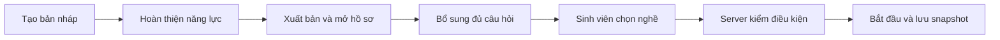

# Thư viện nghề nghiệp — quản trị và phỏng vấn

Nghề nghiệp là vị trí như Frontend Developer hoặc Data Analyst. Vai trò tài khoản là Admin, Giảng viên, Sinh viên. Thêm nghề mới không cấp thêm quyền.

## Cách sử dụng

1. Admin mở **Học tập → Thư viện nghề nghiệp**, URL `/admin/career-roles`.
2. Chọn **Thêm nghề nghiệp**. Đặt mã ổn định, ví dụ `data_analyst`; mã không đổi sau khi tạo. Nhập tên, mô tả công việc, cấp độ và ngôn ngữ.
3. Nhập kỹ năng bắt buộc/tùy chọn, mỗi dòng một kỹ năng. Không lặp giữa hai nhóm. Trọng số gắn với từng kỹ năng bắt buộc; khi điền phải đủ và tổng bằng 100%. Có thể để rỗng khi lưu nháp.
4. Tạo bản nháp. Bản nháp chưa xuất hiện với sinh viên. Chọn **Chỉnh sửa**, hoàn thiện mô tả ít nhất 20 ký tự, kỹ năng/trọng số, chuyển **Đã xuất bản** và bật **Đang nhận hồ sơ**.
5. Mở **Quản lý câu hỏi**, chọn nghề mới. Tối thiểu cần 2 câu Giới thiệu, 6 câu Chuyên môn và 2 câu Tiếng Anh đang dùng. Tiếng Anh tự chọn ngôn ngữ English. Đáp án mẫu và hướng dẫn chấm chỉ dành cho Admin/server, không trả cho sinh viên.
6. Sinh viên mở trang chọn vị trí. Danh sách đến từ server, không cần sửa enum FE khi thêm nghề mới. Chọn nghề và bắt đầu phỏng vấn. Server kiểm lại trạng thái tuyển và bộ câu hỏi trước khi tiêu hao lượt.

## Đọc trạng thái và xử lý lỗi

| Trạng thái/tình huống | Ý nghĩa và cách xử lý |
|---|---|
| Bản nháp | Đang soạn; chưa nhận hồ sơ |
| Đã xuất bản, đóng hồ sơ | Nội dung được duyệt nhưng chưa mở tuyển |
| Đã xuất bản, nhận hồ sơ | Hiện trên danh sách sinh viên; vẫn phải đủ câu hỏi mới bắt đầu được |
| Đã lưu trữ | Không nhận hồ sơ/lượt phỏng vấn mới. Buổi đang làm, kết quả và history vẫn giữ |
| Thiếu câu hỏi (503) | Bổ sung đúng nghề và đúng nhóm; không lấy câu nghề khác. Lượt chưa bị tiêu hao |
| Nghề đã đóng (409) | Tải lại catalog và chọn nghề đang tuyển; không tạo thêm lượt khi lỗi |
| Có người sửa trước (409) | Form giữ bản nháp. Sao chép nội dung đang soạn, đóng form, tải lại danh sách và mở bản mới để đối chiếu; không tự ghi đè |

Nút **Lịch sử** đọc snapshot từng phiên bản, trạng thái, kỹ năng/trọng số và thời điểm. Lưu trữ cần xác nhận. Muốn mở lại, chỉnh sửa với version hiện tại, xuất bản và bật nhận hồ sơ. Không có chức năng xóa cứng role.

## Hướng dẫn bảo trì

| Phần | File chính |
|---|---|
| Route và menu | `src/app/admin/career-roles/page.tsx`, `src/components/product/shell.tsx` |
| Danh sách/lịch sử/lưu trữ | `src/components/admin/career-roles.tsx` |
| Form có version | `src/components/admin/career-role-editor.tsx` |
| Client và runtime parser | `src/lib/api/career-roles.ts` |
| Chọn nghề sinh viên | `src/components/intern/onboarding/role-selection-step.tsx` |
| Biểu tượng cũ | `recruitment-presentation.ts`: chỉ gợi ý hình thức; catalog server quyết định nghề được chọn |
| Ngân hàng câu hỏi | `question-bank.tsx`, `question-editor.tsx`, `src/lib/api/question-bank.ts` |

Server chịu trách nhiệm quyền, code hợp lệ, trạng thái, constraint, khóa cạnh tranh, snapshot và audit. FE không tự tính điều kiện đậu hay đổi số lượt. [Đặc tả BE](https://github.com/vanhoi04082006-pixel/V-Intern-BE/blob/feat/admin-repository-account/SPEC-career-roles.md) mô tả endpoint và ví dụ JSON.

## Kiểm chứng ngày 23/10/2026

- Mốc hiện hành FE `6e6e9c9`: 84 file / **549 test** đạt; lint, typecheck và 21 CI contract đạt. Baseline UI catalog trước đó có 548 test; sau đó bổ sung regression không còn nghề thay thế. Bản production dùng riêng build thành công; [quality của revision mới](https://github.com/vanhoi04082006-pixel/V-Intern-FE/actions/runs/39945967274) đạt.
- Browser thật, không intercept API: tạo draft → publish → hai revision → soạn 10 câu qua UI → tài khoản sinh viên riêng chọn nghề mới → bắt đầu 10 snapshot → archive nhưng buổi đang làm vẫn đọc được → trả lời 10 câu → nộp → chấm và lưu kết quả. SQL xác nhận 10 câu trả lời, quyết định `passed`, 81.1 điểm và prompt v5. Điểm 81.1 là fixture được công bố của harness, không phải đánh giá chất lượng model live.
- Kiểm 1440/1280/1024/768/390 px, không tràn ngang, không page error trong lượt đạt. Evidence local: `manual-runtime/ci-recovery-20261023/phase7-evidence/career-roles/result.json` và ảnh cùng thư mục.
- Script tái lập: `scripts/career-roles-live.mjs`, chỉ chạy với DB disposable của full-stack harness. Workflow giữ 14 bước cũ và thêm một gate riêng cho catalog.
- Cặp app FE `6e6e9c9` / BE `ecc1cb8` đã đạt cả quality và [14 bước + gate catalog trên SQL 2019](https://github.com/vanhoi04082006-pixel/V-Intern-FE/actions/runs/39945967240). Sau đó script catalog được mở rộng đến nộp/chấm; fixture được sửa để trả `recommendedRole=null` ngoài khoảng 50–70. Regression Node mới giữ hợp đồng này; 22/22 contract đạt local. Lượt browser mở rộng đạt ở `career-browser-grade3.log`; các lượt fail trước đó không tính là đạt.

Prompt đánh giá BE v5 dùng danh sách nghề đang tuyển và lưu metadata/version catalog trong input run. Đề xuất ngoài catalog bị từ chối; nếu không có nghề thay thế thì giữ điểm, không tạo nghề giả và thông báo cần định hướng. FE không hiện lời đề xuất khi API trả `recommendedRole=null` ở khoảng 50–70 điểm.

**Giới hạn:** bộ lọc nghề ở màn hình phân công giảng viên và consumer template còn cần chuyển. R03 tổng thể vẫn mở. Các module CV, lịch, Agent runtime, mail và chính sách nộp trễ là các task sau, không được gọi là đã xong chỉ vì có thư viện nghề. Migration mới hiện mới áp dụng DB kiểm thử, chưa thay DB demo chính.

Hiện vẫn giữ luồng chọn nghề thủ công để không phá chức năng đang dùng. Khi M08–M11 hoàn tất, hồ sơ CV được Agent phân tích và xếp lịch mới dùng role được giao; không gọi màn hình hiện tại là nghiệm thu luồng CV tự động.
