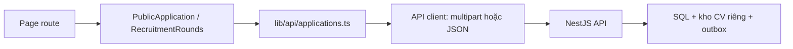

# Hướng dẫn cổng CV và lịch phỏng vấn

G3 thêm một đường vào hệ thống cho người chưa có tài khoản: nộp CV → xác minh email → Agent phân tích → nhận lịch → nhận email đăng nhập riêng. Người dùng không cần tự chọn nghề ở cổng CV. Quy tắc khóa phòng phỏng vấn theo lịch và quá 15 phút thuộc G4; hãy xem báo cáo từng giai đoạn trước khi demo.

## Bản đồ màn hình

| Màn hình | Ai sử dụng? | Việc chính |
|---|---|---|
| `/apply` | Ứng viên, chưa cần đăng nhập | Nộp CV, xác minh, xem tiến độ và bổ sung |
| `/instructor/recruitment-rounds` | Giảng viên | Quản lý đợt/lịch/hồ sơ thuộc quyền mình |
| `/admin/recruitment-rounds` | Admin | Quản lý toàn bộ đợt/lịch/hồ sơ |
| `/admin/communications` | Admin có quyền tương ứng | Xem hàng đợi, preview mail và xử lý gửi lại |
| `/change-password` | Người dùng mật khẩu tạm | Đổi mật khẩu trước khi vào workspace |

## Nếu bạn là giảng viên

1. Đăng nhập và mở **Tuyển dụng & hồ sơ CV** trong menu.
2. Chọn **Tạo đợt tuyển**, đặt tên và khoảng thời gian nhận CV. Tên nên gồm kỳ/nhóm để dễ phân biệt.
3. Chọn đợt vừa tạo, thêm lịch theo nghề. Ví dụ: Frontend, ngày mai 09:00–09:30, múi giờ Việt Nam, sức chứa hai người, chuẩn bị 60 phút, gửi đăng nhập trước 30 phút.
4. Mở đợt và chia sẻ đường dẫn `/apply`. Nếu nghề chưa xuất hiện hoặc API từ chối, kiểm tra nghề đang tuyển, đã xuất bản và đủ bộ câu hỏi.
5. Chuyển sang danh sách hồ sơ, chọn **Xem hồ sơ**. Đọc timeline trước; mở **Phân tích CV & bằng chứng của Agent** để xem lý do và đoạn trích. Có thể tải CV riêng của ứng viên này.
6. Nếu cần, bổ sung lịch rồi thử xử lý lại hồ sơ đang chờ/lỗi; đổi lịch bằng khung giờ còn chỗ cùng nghề. Hủy hồ sơ cần xác nhận để tránh bấm nhầm.

Confidence của Agent giúp diễn giải độ chắc chắn của đề xuất. Nó không phải điểm phỏng vấn và không thay quyết định tuyển cuối cùng. Trích dẫn theo trang/đoạn giúp người đọc kiểm tra ngược với CV.

**Gửi lại liên kết hồ sơ** giúp ứng viên lấy lại quyền xem hồ sơ trên trình duyệt khác. **Gửi lại thông tin đăng nhập** chỉ thử gửi payload của lịch hiện tại còn hợp lệ; thao tác không sinh mật khẩu mới. Nếu mail đang ở trạng thái không chắc chắn, đọc cảnh báo và chỉ xác nhận khi đã đối chiếu để tránh gửi trùng.

## Nếu bạn là ứng viên

1. Mở `/apply`, chọn đợt đang nhận hồ sơ.
2. Nhập đúng email bạn kiểm soát, họ tên, CV PDF/DOCX tối đa 5 MB và xác nhận đồng ý xử lý.
3. Mở email xác minh. Liên kết có hạn và dùng một lần. Sau xác minh, trang tự bỏ token khỏi địa chỉ và hiển thị tiến độ hồ sơ.
4. Nếu báo thiếu thông tin, nộp bản CV bổ sung ngay trên trang theo dõi. PDF chỉ có ảnh scan cần được thay bằng tài liệu có lớp chữ; hệ thống hiện không có OCR.
5. Khi có lịch, đọc email lịch hẹn. Email thứ hai sẽ đến mốc đã cấu hình, có hướng dẫn đăng nhập riêng.
6. Người mới phải đổi mật khẩu tạm trước khi vào workspace. Người đã có tài khoản giữ mật khẩu hiện tại; hệ thống không reset ngầm.

Nếu không thấy lại hồ sơ sau khi đổi trình duyệt, dùng chức năng xin liên kết truy cập bằng cùng đợt/email. Không cần nộp trùng CV. Để giữ riêng tư, phản hồi không cho biết một email cụ thể đã có hồ sơ hay chưa.

## Demo email local

Khi API được cấu hình `MAIL_DELIVERY_MODE=local`, Admin thấy thông báo rõ và đường dẫn inbox `http://localhost:8025`. Đây là hộp thư thử trên máy: mail không đi ra Gmail/Outlook. Cần giữ SMTP sink chạy trong khi demo; dừng sink sẽ mất các mail đang giữ trong bộ nhớ.

Một mail có trạng thái **SMTP đã chấp nhận** chưa đồng nghĩa người nhận đã đọc hoặc hộp thư ngoài đã nhận. **Không chắc chắn** nghĩa có thể SMTP đã nhận trước khi kết nối đứt; hệ thống cần người vận hành đối chiếu trước khi gửi lại.

## Trạng thái và cách tiếp tục

| Bạn thấy gì? | Bước tiếp theo |
|---|---|
| Đang chờ xác minh | Mở email xác minh hoặc xin liên kết mới |
| Đang phân tích | Chờ worker; dùng Làm mới, không nộp lại liên tục |
| Cần bổ sung | Đọc lý do trong timeline và tải bản CV mới |
| Danh sách chờ | Giảng viên cần mở lịch phù hợp hoặc bổ sung sức chứa |
| Đã có lịch | Kiểm tra nghề/giờ/múi giờ và email đăng nhập riêng |
| Liên kết hết hạn | Xin liên kết truy cập mới bằng cùng đợt/email |
| Lỗi tạm thời | Giữ dữ liệu đang nhập, đọc thông báo và Thử lại |

## Bàn giao cho lập trình viên

`src/components/applications/public-application.tsx` xử lý nộp/theo dõi/xác minh. Xác minh qua hash được bắt cả khi người dùng mở link trong tab đã mount; request sequence và dedupe tránh submit lại dưới StrictMode. Cookie ứng viên do Backend quản lý, frontend không đọc hoặc lưu token vào localStorage.

`recruitment-rounds.tsx` dùng chung cho Admin/Giảng viên. `src/lib/api/applications.ts` parse hợp đồng API trước khi đưa dữ liệu vào UI; file download dùng response type `cv`. Với multipart, không tự đặt `Content-Type`: browser phải thêm boundary. API client vẫn kiểm MIME cho các download PDF/XLSX cũ.

`src/components/auth/change-password.tsx` kết hợp guard và `landing.ts` để đưa người dùng mật khẩu tạm tới đúng màn hình. Không bỏ guard hoặc cho phép vào workspace bằng direct URL để né bước đổi mật khẩu.

Các màn hình dùng component chung `PageTitle`, `Modal`, `Pager`, `Empty`, `LoadingState`, `ErrorState` và `useAction`. Giữ thao tác đang gửi disabled, nội dung lỗi đọc được, form không mất dữ liệu khi request lỗi. Test nằm cùng component/API; harness browser ở `scripts/g3-applications-live.mjs`.

Đọc sâu phần transaction, parser, Agent và mail tại [tài liệu BE](https://github.com/vanhoi04082006-pixel/V-Intern-BE/blob/codex/g3-cv-scheduling/docs/CV-AND-INTERVIEW-SCHEDULING.md). Số liệu kiểm chứng được chốt trong [báo cáo G3](reports/g3-completion-20261024.md), có phân biệt model deterministic, provider thật và SMTP local.
