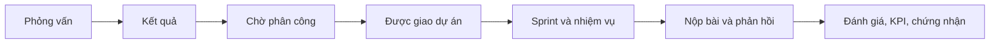
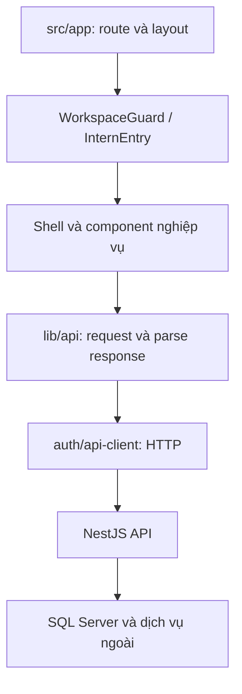
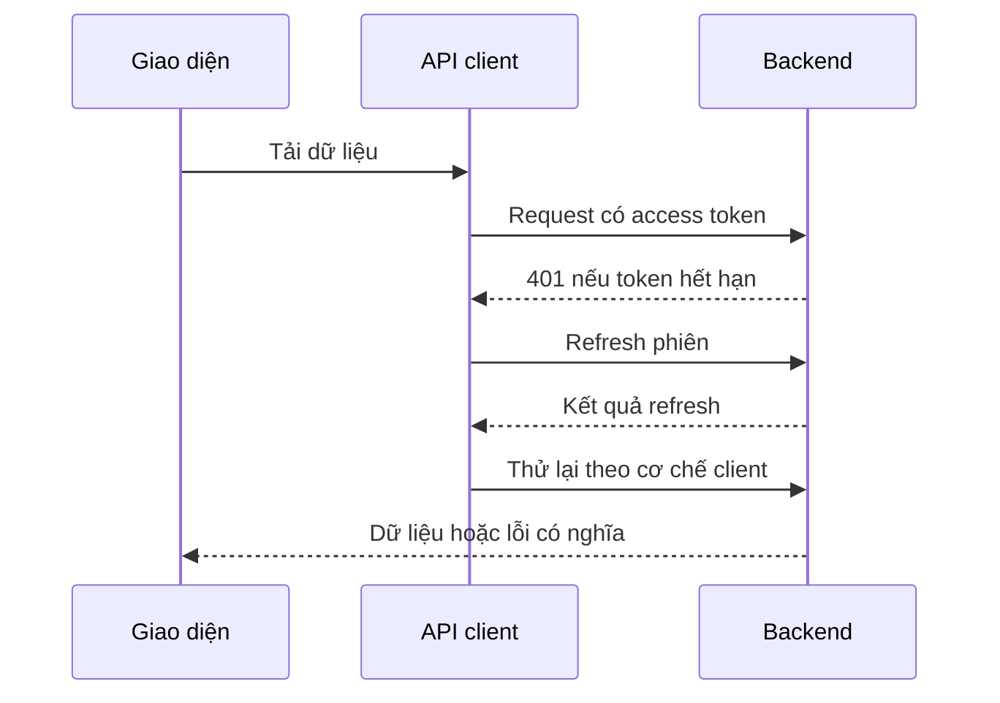

# Bàn giao Frontend V-Intern

> **Cập nhật G7 ngày 25/10/2026:** [bộ bàn giao hiện tại](DELIVERY-20261025.md) và [bằng chứng có nguồn](reports/g7-local-acceptance-20261025.json). BE 840 / FE 638 unit test; 17/17 bước full-stack local đạt; hai DB native đã kích hoạt G6/G7. CI GitHub cuối chưa chạy do billing.

> Dành cho người tiếp nhận sản phẩm, lập trình viên và người kiểm thử. Đọc theo thứ tự nếu bạn mới vào dự án; dùng bảng dưới để đi thẳng đến phần cần tra cứu.

| Bạn muốn làm gì? | Bắt đầu ở đâu? |
|---|---|
| Mở ứng dụng trên máy hiện tại | [Chạy local](#1-chạy-local-và-xác-nhận-đúng-bản) |
| Hiểu sinh viên và giảng viên dùng hệ thống thế nào | [Hành trình sử dụng](#2-hiểu-sản-phẩm-qua-một-kỳ-thực-tập) |
| Biết cần sửa file nào | [Kiến trúc và bản đồ code](#3-từ-một-trang-đến-dữ-liệu-thật) |
| Sửa giao diện mà vẫn đồng bộ | [Aurora Glass](#5-thiết-kế-aurora-glass) |
| Kiểm thử và xử lý lỗi | [Bảo trì](#7-kiểm-thử-và-bàn-giao-một-thay-đổi) |
| Đối chiếu toàn bộ URL | [Danh mục route từ source](ROUTE-MAP.md) |
| Hiểu API/SQL/AI/GitHub phía sau | [Bàn giao Backend](https://github.com/vanhoi04082006-pixel/V-Intern-BE/blob/feat/admin-repository-account/docs/HANDOVER.md) |

## 1. Chạy local và xác nhận đúng bản

Frontend là ứng dụng Next.js 16.4.2, React 19, TypeScript, Tailwind CSS 4. API nghiệp vụ chạy riêng bằng NestJS. Giao diện mở được chưa có nghĩa API hoặc database đã sẵn sàng.

### Trên máy V-INTERN hiện tại

Mở PowerShell tại thư mục gốc repository. Trong **mỗi process** chạy npm/build/test, kích hoạt quy định lưu trữ trước:

```powershell
& .\scripts\Use-ProjectStorage.ps1
# Chạy tại thư mục gốc repository Frontend
```

| Thành phần | Địa chỉ local | Ý nghĩa |
|---|---|---|
| FE chính | http://localhost:3001 | `next start`, dùng bản đã build |
| API chính | http://localhost:8080/api/v1 | Launcher trỏ vào `VIntern_M2_BROWSER` |
| API QA | http://localhost:8081/api/v1 | Launcher trỏ vào `VIntern_Test_Learning_20261014` |
| Swagger | http://localhost:8080/api/docs | API và schema của bản đang chạy |

Các giá trị trên mô tả máy bàn giao, không phải hằng số để nhúng vào component. `NEXT_PUBLIC_API_BASE_URL` phải chứa đầy đủ tiền tố `/api/v1`. Biến `NEXT_PUBLIC_*` được đưa vào bundle khi build; đổi `.env` rồi chỉ restart sẽ không cập nhật bundle cũ.

```powershell
# Kiểm tra source trước khi thay bản local
npm run lint
npm run typecheck
npm test
npm run build
# Chỉ restart sau khi build thành công
& ..\manual-runtime\restart-owned-apps.ps1 -Frontend
```

Không chạy hai process dev dùng chung thư mục `.next`. Nếu cổng bận, kiểm tra process sở hữu trước; không dừng toàn bộ Node trên máy. Không chạy seed/reset để làm xuất hiện dữ liệu trên UI.

### Khi tiếp nhận trên máy mới

1. Cài Node theo `engines` trong `package.json` (Node 22 trở lên), chuẩn bị backend theo hướng dẫn BE.
2. Cài đúng lockfile bằng `npm ci`, sau khi cấu hình cache/temp theo quy định lưu trữ của máy.
3. Tạo cấu hình môi trường cục bộ theo file mẫu trong repo; không đưa secret vào biến public.
4. Chạy `npm run dev`, mở URL mà terminal công bố. Repo mặc định dùng cổng 3001.
5. Đăng nhập bằng tài khoản được bàn giao qua kênh riêng. Không đưa mật khẩu vào README hoặc ảnh chứng minh.

## 2. Hiểu sản phẩm qua một kỳ thực tập

Giả sử Lan là sinh viên, cô Mai là giảng viên. Lan chọn chuyên môn và trả lời phỏng vấn. Sau khi đạt, Lan có thể vẫn đang chờ phân công. Cô Mai chọn mẫu dự án, tạo phiên và phân công Lan. Khi kế hoạch được xác nhận và Sprint được kích hoạt phù hợp, Lan mới có nhiệm vụ thật để thực hiện.



### Sinh viên: mỗi khu vực dùng để làm gì?

| Khu vực | Cách dùng | Điều cần hiểu |
|---|---|---|
| Tổng quan | Xem dự án, tiến độ và việc cần tiếp tục | Con số phản ánh dữ liệu của bạn, không phải toàn hệ thống |
| Công việc | Tìm task, chuyển list/Kanban, mở chi tiết | Kéo thẻ vẫn phải tuân thủ trạng thái, phụ thuộc và quyền sở hữu |
| Sprint | Đọc mục tiêu giai đoạn và nhiệm vụ | Giảng viên có bản nháp chưa đồng nghĩa Sprint đã sẵn sàng cho bạn |
| Dự án | Đọc yêu cầu, công nghệ và sản phẩm bàn giao | Repository và tài liệu là nguồn thực hiện, không chỉ mô tả trang trí |
| AI Mentor | Chọn ngữ cảnh rồi đặt câu hỏi | Gợi ý học tập không tự sửa task hay chốt điểm |
| Đánh giá / Hiệu suất / KPI | Đọc điểm, tiêu chí và nguồn dữ liệu | Điểm AI đề xuất và kết quả đã chốt là hai thứ khác nhau |
| Lương ảo | Đối chiếu số dư và biến động | Đây là dữ liệu mô phỏng trong hệ thống |
| Chứng nhận | Mở chứng nhận đã phát hành | Không có bản ghi là trạng thái hợp lệ |
| Khuyến nghị | Làm mới đề xuất khi chức năng khả dụng | Lần đầu có thể chưa có kết quả được tạo |
| GitHub | Kiểm tra danh tính liên kết và repository | Tài khoản cấp repo do Admin quản lý; danh tính người nộp bài vẫn cần đúng |
| Thông báo / Hồ sơ | Xem cập nhật và thông tin cá nhân | Làm mới hồ sơ không tạo lại tài khoản |

### Giảng viên: đi theo thứ tự này

1. **Thư viện dự án:** đọc yêu cầu và vai trò của mẫu, chọn phiên bản phù hợp.
2. **Phiên thực tập:** chuẩn bị thời gian, đội hình và phân công. Kiểm tra đúng sinh viên/vai trò trước khi xác nhận.
3. **Kế hoạch:** xem bản nháp AI, sửa nội dung và xác nhận. Bản nháp là bước chuẩn bị, không phải task đã phát hành.
4. **Sprint & Task:** mở công việc thực tế, theo dõi tiến độ, bài nộp và cảnh báo quá hạn.
5. **Đánh giá:** xem bằng chứng và gợi ý, tự đưa ra điểm cuối theo quyền được cấp.
6. **Báo cáo:** tạo/xem bản chụp kết quả và xuất khi cần. Báo cáo cũ không tự thay đổi theo task mới.
7. **Chia sẻ dữ liệu:** đọc phạm vi và trạng thái đồng ý trước khi chia sẻ.

### Ba điểm dễ nhầm

- **Đậu tuyển dụng không tự có dự án.** FE lấy lifecycle từ API để biết nên mở onboarding, màn chờ hay workspace.
- **Kéo sang Chờ duyệt không bỏ qua nộp bài.** Giao diện mở luồng nộp bài theo hành vi hiện có.
- **Điểm 0 không phải thiếu dữ liệu.** Biểu đồ không đổi giá trị chưa đo được thành 0 hoặc thêm đường xu hướng giả.

## 3. Từ một trang đến dữ liệu thật



| Thư mục/file | Trách nhiệm | Khi nào cần mở? |
|---|---|---|
| `src/app` | URL, layout và điểm vào trang | Thêm route hoặc kiểm tra trang đang render component nào |
| `components/auth` | Form đăng nhập, guard, kiểm tra quyền hiển thị | Lỗi chuyển trang theo vai trò hoặc thao tác bị ẩn |
| `components/intern` | Shell sinh viên, dashboard và trải nghiệm học tập | Tinh chỉnh hành trình sinh viên |
| `components/intern/onboarding` | Chọn role, hội thoại, kết quả tuyển dụng | Các trạng thái phỏng vấn, retry, hết lượt |
| `components/sessions` | Phiên, kế hoạch, Sprint, báo cáo | Tinh chỉnh luồng giảng viên |
| `components/instructor` | Adapter và thành phần dành cho giảng viên | Tiêu đề, số liệu, chọn thành viên, bố cục |
| `components/product` | Form/luồng nghiệp vụ dùng chung | Chi tiết task, đánh giá, GitHub, Mentor, outcomes |
| `components/workspace` | Header, artwork, chart, stage, CSS | Thiết kế đồng bộ hai vai trò |
| `lib/api` | Transport có xác thực, parser và API theo domain | Đọc payload, xử lý lỗi hoặc mapping dữ liệu |
| `lib/auth` | Trạng thái phiên, login/refresh/logout | Debug session và request 401 |

### Vì sao có hai shell?

Sinh viên cần biết trạng thái tuyển dụng và phân công trước khi cho phép vào nội dung học tập. `InternEntry` và context workspace giữ dữ liệu đó ở layout để không dựng lại sidebar sau mỗi lần chuyển tab. Giảng viên dùng `ProductShell` trong layout có guard vai trò. Aurora dùng cùng token/bề mặt cho hai shell nhưng không gộp hai cơ chế xác thực thành một đường tắt.

### Một lần tải dữ liệu

`useResource` giúp component biểu diễn loading/error/data và tải lại. Hàm API gọi `request`, transport gắn access token rồi parser kiểm response. Nếu chuyển trang trong lúc request đang chạy, `AbortSignal` giúp hủy request không còn cần thiết.

Response sai cấu trúc phải được nhận diện ở parser. Không dùng `as any`, biến dữ liệu lỗi thành danh sách rỗng, hoặc gắn dữ liệu mẫu để làm màn hình có vẻ hoạt động.

## 4. Phiên đăng nhập và thao tác thay đổi dữ liệu

Access token được giữ trong bộ nhớ phía client. Refresh đi qua cơ chế cookie của backend. Khi request nhận 401, lớp client phối hợp refresh và thử lại có giới hạn; không tạo vòng lặp retry vô tận. BroadcastChannel chỉ truyền sự kiện hủy phiên, không truyền token hoặc hồ sơ người dùng.



Với mutation, luôn phản ánh trạng thái đang gửi, chặn gửi lặp và giữ dữ liệu form khi lỗi. Thành công cần cập nhật dữ liệu liên quan, không chỉ đóng modal. Xung đột version, task chưa đủ điều kiện, sai người sở hữu hoặc Sprint còn việc mở phải hiện thông báo đúng; FE không tự lách guard ở BE.

## 5. Thiết kế Aurora Glass

Nguồn chính: [`aurora.css`](../src/components/workspace/aurora.css), chạy sau `workspace.css`. `aurora-workspace` chỉ gắn vào Sinh viên/Giảng viên và onboarding. Trang chủ, auth và Admin có phạm vi riêng.

| Vai trò thiết kế | Giá trị / quy tắc |
|---|---|
| Chữ chính | `--ws-ink`: #20243c |
| Chữ phụ | `--ws-muted`: #626b83 |
| Hành động chính | `--ws-primary`: #5847df |
| Màu nền nhẹ | Lavender #eeeaff; mint #e0f4ee; rose #ffe8ee |
| Control / object / shell | Radius 10 / 16 / 24px, không áp một radius cho mọi thứ |
| Typography | Giữ Geist đã có; tiêu đề 23–30px, nội dung dễ đọc |
| Motion | Phản hồi ngắn 180ms; reduced motion tắt chuyển động |
| Glass | Blur ở navigation; dữ liệu đặt trên bề mặt trắng đủ rõ |
| Illustration | Robot có sẵn ở header dẫn dắt; hình trang trí có alt rỗng |

Sidebar nổi giúp tách điều hướng khỏi công việc. Header có một tiêu đề chính, một lời dẫn ngắn và hành động theo ngữ cảnh. Tab khu vực là lối tắt, không lặp lại một đoạn giới thiệu dài. Màu semantic diễn đạt thành công/cảnh báo/lỗi cùng với chữ; người dùng không phải đoán trạng thái chỉ qua màu.

### Quy tắc thêm component

- Tái sử dụng `WorkspacePageHeader`, `StudentPanel`/`Panel`, form primitives, chart và empty/error states trước khi tạo thành phần mới.
- Một object độc lập như dự án/task có thể có surface. Không bọc thêm card quanh từng field bên trong một form.
- Dùng số liệu thật, ghi rõ phạm vi: toàn bộ bộ lọc hay chỉ trang đang hiển thị.
- Donut có chú giải tương tác bằng bàn phím. Thanh so sánh có giá trị bằng chữ. Đơn vị điểm và phần trăm phải đúng.
- Nút chỉ có icon phải có accessible name. Đóng dialog trả focus về thao tác mở; Escape phải hoạt động.
- Tại mobile, tab cuộn ngang trong vùng của nó; bảng cuộn trong container; trang không tràn ngang.

Các file CSS cũ vẫn chứa quy tắc giao diện trước đây. Aurora là lớp chuyển tiếp có phạm vi, chưa phải cuộc xóa bỏ hoàn toàn CSS lịch sử. Khi dọn tiếp, cần đối chiếu computed style và ảnh ở cả hai vai trò trước khi xóa selector.

## 6. Các trạng thái bắt buộc

| Trạng thái | Giao diện nên làm gì? | Tránh |
|---|---|---|
| Đang tải | Skeleton/loading có tên rõ | Hiện 0 như kết quả đã tải |
| Chưa có dữ liệu | Nói dữ liệu nào chưa có và bước tiếp theo phù hợp | Dữ liệu mẫu đóng vai dữ liệu thật |
| Bộ lọc không có kết quả | Giữ filter và cho đặt lại | Khẳng định hệ thống không có bản ghi |
| Lỗi request | Giữ ngữ cảnh, thông báo, retry khi hợp lý | Nuốt lỗi và hiện empty state |
| Đang gửi | Disable thao tác lặp, giữ draft | Xóa form trước khi server xác nhận |
| Thành công | Hiện kết quả và cập nhật collection liên quan | Chỉ đổi màu nút |
| Hết quyền / hết phiên | Theo guard và quy tắc auth | Chỉ ẩn nút rồi coi là bảo mật |

## 7. Kiểm thử và bàn giao một thay đổi

Làm lần lượt: đọc route → xác định component → sửa phần nhỏ có phạm vi → chạy check liên quan → xem trình duyệt → chạy quality gate của repo. Với Next.js phiên bản hiện tại, đọc tài liệu cục bộ trong `node_modules/next/dist/docs` trước khi đổi API framework.

```powershell
& .\scripts\Use-ProjectStorage.ps1
npm run lint
npm run typecheck
npm test
npm run build
git diff --check
```

Browser cần kiểm tra desktop, tablet và mobile; login đúng vai trò; sidebar/drawer; tab; bảng; modal; filter; loading/error; Kanban bàn phím. Không thay điểm, tạo chứng nhận hoặc reset dữ liệu chính chỉ để chụp giao diện. Flow cần mutation nên dùng fixture QA riêng.

Số test và ảnh kiểm chứng nằm tại [VERIFICATION](VERIFICATION.md). Một ảnh đẹp không chứng minh toàn bộ API đúng; một suite xanh không chứng minh bố cục mobile đúng. Ghi cả phạm vi đã kiểm và phần chưa có dữ liệu để kiểm.

## 8. Tìm lỗi theo triệu chứng

| Triệu chứng | Kiểm tra đầu tiên | Hướng xử lý |
|---|---|---|
| Sửa code nhưng UI không đổi | Đang chạy `next start` hay dev? | Build rồi restart đúng FE |
| Không đăng nhập được | API URL, health, CORS/cookie | Đọc lỗi cụ thể; không reset tài khoản |
| Sinh viên thấy chờ, giảng viên thấy kế hoạch | Assignment/lifecycle, draft/publish, Sprint | Sửa đúng bước chuẩn bị theo BE |
| Kéo task bị chặn | Mã lỗi và `blockedBy`, version, owner | Hiện đúng điều kiện cần hoàn thành |
| Mọi trang chờ lâu | API và SQL health/log | Tách lỗi dữ liệu khỏi lỗi CSS |
| Có khoảng trắng hoặc tràn ngang | Viewport, grid min-width, nội dung dài | Sửa container đúng tầng; không che cả trang bằng overflow hidden |
| Chỉ một vai trò sai style | Class scope và thứ tự import CSS | Kiểm computed style, không đổi global token của trang chủ |

## 9. Giao lại cho người tiếp theo

Đính kèm commit/branch, file đã đổi, kết quả lệnh, ảnh thật, giới hạn và đường dẫn tài liệu liên quan. Hai repo có lịch sử riêng. Xem [đối chiếu nhánh](GIT-WORKFLOW.md) trước khi merge. Không dùng `reset --hard`, `clean -fd` hoặc checkout đè working tree đang có việc.

Thông tin đăng nhập và cấu hình thật được bàn giao riêng. Thư mục `manual-runtime/private` là dữ liệu cục bộ, không phải tài liệu công khai để đưa lên GitHub.
