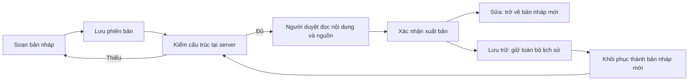

# Kho tri thức Agent — hướng dẫn biên soạn và bàn giao

**Dành cho:** Admin duyệt nội dung và kỹ sư tiếp nhận Frontend. Mở **Học tập → Kho tri thức Agent** tại `/admin/knowledge`.

Kho lưu hướng dẫn, câu hỏi với nhiều hướng trả lời đúng, lời giải và tiêu chí chấm có nguồn. Đây là nền tảng cung cấp ngữ cảnh có kiểm soát cho các Agent. **Ở mốc K03, kho chưa nối vào các lượt chạy AI hiện tại.** Xuất bản một tài liệu không có nghĩa model đã được huấn luyện lại hoặc Agent đã dùng tài liệu đó.

## 1. Chọn đúng loại nội dung

| Bạn muốn chuẩn bị | Loại tài liệu | Lưu ý |
|---|---|---|
| Hướng dẫn đọc lỗi Git | Hướng dẫn | Có thể dùng phạm vi hỗ trợ học tập; không chèn đáp án chấm |
| Đánh giá cách xử lý Promise | Câu hỏi & trả lời | Có ít nhất hai cách trả lời đúng, ví dụ, lỗi thường gặp, câu hỏi sâu, ví dụ yếu và rubric |
| Bài thực hành nhỏ | Bài tập | Nêu đầu vào, đầu ra và cách kiểm chứng |
| Lời giải bài thực hành | Lời giải | Luôn riêng cho chấm; không gộp vào hướng dẫn cho sinh viên |
| Tiêu chí đánh giá | Tiêu chí chấm | Mô tả bằng chứng từng tiêu chí; tổng trọng số 100% |
| Khung kế hoạch | Mẫu kế hoạch | Mục đích lập kế hoạch, phạm vi nội bộ |
| Nội dung thư mời | Mẫu liên lạc | Biên soạn nội dung; thao tác này chưa gửi email |

## 2. Soạn tài liệu đầu tiên

1. Chọn **Soạn tài liệu**. Mã dài 2–80 ký tự, bắt đầu bằng chữ thường, chỉ gồm chữ thường, số, `_` hoặc `-`. Ví dụ `git-read-errors`. Mã giữ nguyên sau khi tạo; tiêu đề có thể sửa.
2. Chọn loại, nhập tiêu đề và mô tả năng lực/tình huống. Có thể lưu mô tả chưa hoàn thiện; trước xuất bản cần ít nhất 20 ký tự.
3. Soạn phần nội dung. Q&A có từng ô riêng cho từng cách trả lời; mỗi ô giữ được nhiều dòng, không tách câu chỉ vì xuống dòng. Có thể thêm hoặc xóa từng mục.
4. Thêm nguồn. Mỗi nguồn có tên và URL HTTPS hoặc tham chiếu tài liệu nội bộ. URL không kèm tên đăng nhập/mật khẩu. Hệ thống giữ trích dẫn, không tự tải trang nguồn.
5. Chọn phạm vi, mục đích và nghề liên quan. Danh sách nghề lấy từ catalog; không chọn nghề nghĩa là dùng chung. Không tự hiểu là có quyền đọc dữ liệu của mọi sinh viên.
6. Chọn **Lưu bản nháp**. Server trả phiên bản thật; mỗi lần lưu tạo lịch sử mới. Không cần viết đủ toàn bộ tiêu chí xuất bản để lưu nháp.
7. Chọn **Xem trước** để đọc cách trình bày. Bản xem trước hiện nội dung đang soạn, gồm cả thay đổi chưa lưu; khác với kiểm xuất bản chỉ kiểm bản đã lưu.

Đổi loại tài liệu cần xác nhận vì cấu trúc nội dung sẽ được thay mới. Tiêu đề, nguồn và nghề được giữ; mục đích được gợi ý lại. Phạm vi không tự hạ từ mức riêng tư hơn. Nếu một bản nháp nhập ngoài có trường chưa được hỗ trợ, UI giữ nguyên dữ liệu khi lưu và chỉ loại khi người soạn bấm nút bỏ/đặt lại tương ứng.

## 3. Viết Q&A giúp chấm công bằng

Ví dụ câu hỏi: “Bạn xử lý lỗi Promise và phản hồi cho người dùng thế nào?”

| Phần | Ví dụ cách biên soạn |
|---|---|
| Ý chính mong đợi | Bắt lỗi, trạng thái tải kết thúc, người dùng nhận thông báo, có kiểm thử |
| Cách đúng thứ nhất | `async/await` và `try/catch/finally`, giải thích từng trạng thái |
| Cách đúng thứ hai | Chuỗi Promise với `.catch/.finally`, kiểm thử Promise bị từ chối |
| Câu minh họa | Một lời giải thích có ví dụ cụ thể và giới hạn của cách làm |
| Lỗi thường gặp | Nuốt lỗi hoặc bỏ quên trạng thái tải |
| Câu hỏi đào sâu | Cách kiểm thử lỗi mạng mà không phụ thuộc mạng thật |
| Ví dụ chưa đạt | Chỉ nói “dùng await” mà không chứng minh kiểm soát lỗi |
| Rubric | Đúng kỹ thuật 60%, kiểm chứng và giải thích 40%; mô tả bằng chứng cho từng phần |

Đừng nhân bản một đáp án bằng cách đổi hoa/thường. Mục đích là nhận diện năng lực qua các cách giải thích tương đương, không buộc sinh viên học thuộc chuỗi mẫu. Thanh trọng số phản ánh tổng đang nhập; 100% chỉ chứng minh đủ trọng số, chưa chứng minh tiêu chí đúng chuyên môn.

## 4. Kiểm và xuất bản

Sau khi lưu, chọn **Kiểm tra & xuất bản**. UI gọi endpoint chỉ đọc `/admin/knowledge/:code/publication-check` và đối chiếu cả version lẫn SHA-256 với tài liệu đang xem.

| Kết quả | Cần làm |
|---|---|
| Cần hoàn thiện | Đóng kiểm tra, sửa nội dung theo lý do, lưu rồi kiểm lại |
| Phiên bản trên hệ thống đã thay đổi | Đối chiếu bản mới; không đổi version thủ công để ghi đè |
| Đã đủ cấu trúc | Đọc lại chuyên môn, nguồn và phạm vi, rồi xác nhận xuất bản |

Server kiểm lại quyền, version và cấu trúc khi thực sự xuất bản. Bản kiểm không giữ chỗ hoặc khóa tài liệu. Nếu người khác sửa sau khi kiểm, publish có thể trả conflict và không tạo revision mới.

Q&A, lời giải và rubric luôn thuộc **Riêng cho chấm**. Không chuyển đáp án sang hướng dẫn hỗ trợ học tập để vượt phân loại. **Nội bộ** phù hợp với tài liệu vận hành; **Hỗ trợ học tập** dành cho kiến thức an toàn khi dùng đúng scope.

## 5. Tìm, sửa và khôi phục

Danh sách hỗ trợ từ khóa theo tên/mã, trạng thái, loại, phạm vi, mục đích và nghề. Bộ lọc đổi thì quay về trang đầu. Danh sách chỉ nhận metadata; mở xem trước/chi tiết mới tải body. Trang chi tiết có liên kết đến Thông tin, Nội dung, Nguồn, Phạm vi.

Sửa tài liệu đã xuất bản và lưu sẽ tạo **bản nháp mới**; phải duyệt lại. Chọn **Lưu trữ** để dừng dùng cho lượt retrieval mới khi K04 được nối; dữ liệu lịch sử vẫn giữ. Không có nút xóa vật lý nội dung đã lưu.

Trong **Lịch sử**, chọn một phiên bản để đọc toàn bộ snapshot và nguồn. Phần dấu kiểm chứng hiển thị SHA-256 và mã người thực hiện. Chọn khôi phục, đọc xác nhận rồi bấm lần nữa: hệ thống chép nội dung cũ thành bản nháp với version tiếp theo, không quay lùi số hoặc sửa phiên bản cũ.

Ví dụ: draft 1 → published 2 → sửa thành draft 3 → archived 4 → khôi phục nội dung 2 thành draft 5. Snapshot và hash của bản 2 giữ nguyên.

## 6. Xung đột và thay đổi chưa lưu

Nếu lưu nhận `KNOWLEDGE_VERSION_CONFLICT`, UI giữ nội dung đang soạn. Chọn **Đối chiếu bản mới** để xem server; đóng hộp thoại để tiếp tục bản của mình, hoặc chủ động chọn **Bỏ phần chưa lưu và dùng bản này**. UI không tự gộp hai bản.

Refresh/đóng tab có cảnh báo trình duyệt khi bản nháp chưa lưu. Liên kết **Kho tri thức** trong trình soạn hỏi xác nhận trước khi rời trang. **Giới hạn:** chưa chặn mọi điều hướng SPA từ sidebar hoặc nút Back của trình duyệt; hãy lưu trước khi dùng các lối đi đó. Không có autosave hoặc cơ chế khôi phục bản chưa gửi sau khi đóng trình duyệt.

## 7. Kiểm file import

Chọn **Kiểm tra import**, tải JSON tối đa 80 KB, chứa 1–50 hàng `{code,draft}` dưới dạng mảng hoặc object `entries`. Bấm **Kiểm tra lô** để server kiểm từng hàng.

Kết quả phân biệt **có thể lưu nháp** và **đủ cấu trúc xuất bản**; báo mã đã tồn tại, version hiện tại, lỗi draft và lỗi publish. File hợp lệ không tự tạo tài liệu. Không có mutation/import hàng loạt ở thao tác này; cần biên soạn và lưu từng tài liệu qua luồng thường.

## 8. Quyền và cấu trúc code

| Quyền của Admin | Thao tác |
|---|---|
| `knowledge.read` | Tìm, đọc, xem trước, lịch sử, kiểm bản đã lưu |
| Thêm `knowledge.manage` | Tạo/sửa, kiểm file import, lưu trữ, khôi phục |
| Thêm `knowledge.publish` | Duyệt xuất bản; không tự cấp quyền biên soạn |

Backend là nơi quyết định quyền hiệu lực. Giảng viên/sinh viên không được đọc kho tác giả dù một role tùy chỉnh được gán các permission trên.

| Source | Trách nhiệm |
|---|---|
| `src/app/admin/knowledge/` | Ba route; page động await params theo Next hiện hành |
| `src/lib/api/knowledge.ts` | Adapter và parser chặt chẽ, không gửi field danh tính server trong draft |
| `src/components/admin/knowledge/library.tsx` | Danh sách, tìm/lọc, xem trước, phân trang |
| `editor.tsx` | Trạng thái bản đang soạn/đã lưu, quyền thao tác, xung đột, lifecycle |
| `content-editor`, `text-list-field`, `rubric-field` | Biên soạn có cấu trúc, giữ multiline/trường draft chưa hỗ trợ |
| `scope-editor`, `sources-editor` | Phạm vi, nghề, trích dẫn |
| `publication-review`, `history`, `compare-latest` | Duyệt bản đã lưu, lịch sử và thay thế có xác nhận |
| `preview`, `import-preview`, `failure`, `access` | Preview inert, dry-run, thông báo lỗi an toàn, quyền UI |

Không thêm dependency mới. Preview dùng React text, hỗ trợ đoạn văn/tiêu đề/danh sách/khối mã; không thực thi HTML hoặc ảnh nhúng. Chỉ trích dẫn HTTPS hợp lệ được mở thành liên kết. [Bằng chứng kiểm thử](reports/knowledge-library-20261024.md).
