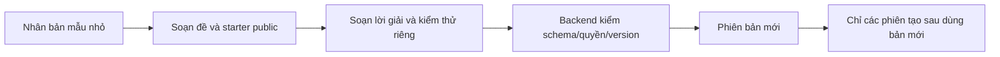

# Dùng thư viện dự án nhỏ — hướng dẫn Admin, giảng viên và sinh viên

Chương này đi theo một bài thực hành từ lúc soạn đề đến lúc sinh viên tải starter. Bạn không cần hiểu JSON để đọc bài, tải code hoặc dùng tài liệu chấm. JSON nâng cao dành cho người cần sửa cấu trúc Sprint/task của blueprint.

## 1. Chọn lộ trình của bạn

| Bạn là ai? | Mở ở đâu? | Làm gì tiếp? |
|---|---|---|
| Admin | `/admin/templates` | Tìm mẫu → xem → nhân bản/chỉnh sửa → lưu phiên bản mới |
| Giảng viên | `/instructor/projects` | Chọn mẫu → đọc gói học tập → khởi tạo phiên → phân công sinh viên |
| Sinh viên đã được giao dự án | `/intern/work` | Mở starter và hướng dẫn dự án → đọc file → tải ZIP |

Sinh viên không có quyền đọc kho đề/chấm toàn hệ thống. Khu vực của sinh viên lấy gói của **phân công chính chủ**. Nếu chưa có phân công, hệ thống không lấy một mẫu bất kỳ để hiển thị thay.

## 2. Admin: soạn một mẫu có thể dùng được

Cách dễ bắt đầu là nhân bản một trong sáu mẫu `MINI-*`. Bản nhân có mã riêng; lời giải riêng của nguồn không tự bị sao chép sang bản mới. Đọc nội dung và điều chỉnh trước khi lưu.

1. Điền tên, mã và mô tả ngắn. Mã cần dễ nhận diện; tránh đưa email hoặc thông tin cá nhân vào mã.
2. Trong **Nội dung học tập**, điền công nghệ, chức năng, mã nghề, điều kiện hoàn thành và phạm vi. Mỗi dòng là một mục. Điền hướng dẫn dự án bằng ngôn ngữ sinh viên có thể làm theo.
3. Mở **Nâng cao · Sprint, task và cấu trúc blueprint** khi cần sửa task, dependency, roleDetails, architecture hoặc milestone. Các field phổ biến giữ nguyên metadata nâng cao; hệ thống không tự bỏ phần chưa biết.
4. Bật **Đính kèm gói starter công khai**. Kiểm kiến thức đầu vào, hướng dẫn chuẩn bị, cách chạy, file code và dữ liệu giả.
5. Xem phần **Tài liệu chấm riêng** nếu bạn có quyền. Chọn giữ nguyên, thay nội dung hoặc bỏ ở phiên bản mới. Không dán đáp án vào blueprint public.
6. Lưu. Backend kiểm toàn bộ schema, quan hệ task và quyền trước khi nhận. Lưu thất bại thì nội dung đang soạn vẫn còn trong form.

Một bài nhỏ nên có 1–2 Sprint, 3–6 task và khoảng 3–7 ngày. Không thêm đăng nhập, thanh toán hoặc cloud vào bài chỉ cần xử lý mảng. Trước khi giao, người soạn phải tự chạy cả bài đúng và ví dụ sai; đừng chỉ kiểm xem file tồn tại.

### Viết tài liệu chấm

| Mục | Điền thế nào? | Lỗi cần tránh |
|---|---|---|
| Lời giải | File tham khảo với đường dẫn tương đối | Đặt lời giải vào starter sinh viên |
| Kiểm thử riêng | File kiểm hành vi và các cạnh dễ sai | Gọi public tests là hidden test |
| Rubric | Tiêu chí, cách kiểm, trọng số tổng 100% | Chỉ ghi “code sạch” mà không nói cách đánh giá |
| Mapping | Task key → mã suite → SHA-256 | Tự nhập digest rồi coi runner đã được seal |

Metadata suite trong form không tự cấp quyền thực thi. Việc seal runner theo repository/task/spec/image do operator thực hiện phía BE. Giao diện không chạy nội dung file và không giả lập receipt thành công.

### Khi gặp xung đột phiên bản

Hai người có thể mở v2 cùng lúc. Người đầu lưu thành v3; người thứ hai nhận `409 TEMPLATE_VERSION_CONFLICT`. Form giữ nội dung chưa lưu để bạn đối chiếu, sao chép phần cần thiết và mở bản hiện tại. Không tự gửi lại bằng cách bỏ expectedVersion; điều đó có thể ghi đè phần người khác vừa sửa.

## 3. Giảng viên: đọc đề và tạo phiên

Mở **Thư viện dự án**, lọc theo tên/mã hoặc nhóm **Bài nhỏ · có starter**. Trang chi tiết cho biết phạm vi, kiến thức cần có, cách chạy, file public và version.

- **Tải starter ZIP** tạo ZIP ngay trong trình duyệt từ các file public đã kiểm. Giữ đường dẫn bên trong khi giải nén.
- **Xem lịch sử phiên bản** cho phép đọc gói public cũ; đổi version không sửa phiên đang chạy.
- **Mở tài liệu chấm riêng** chỉ hiện khi có quyền và chỉ tải nội dung khi người dùng mở. Lịch sử chấm gắn cùng version, không tự lấy lời giải mới nhất thay cho bản cũ.
- **Khởi tạo phiên thực tập** vẫn dùng API hiện hữu, có ngày bắt đầu/kết thúc và request ID chống tạo trùng. Sau đó dùng luồng phân công/Sprint đang có.

Chọn v1 trong phần xem lịch sử chỉ đổi **bản đang đọc**. Nút khởi tạo vẫn tạo từ phiên bản hiện tại của template; muốn sử dụng nội dung cũ cho một phiên mới, Admin cần biên soạn/nhân bản thành mẫu phù hợp trước.

## 4. Sinh viên: nhận đúng bài đã được giao

1. Mở **Công việc của tôi** sau khi có phân công dự án.
2. Chọn **Mở starter và hướng dẫn dự án**. Xem mã mẫu và dòng **bản được giao vN**.
3. Đọc kiến thức cần có, hướng dẫn thiết lập và lệnh kiểm chứng.
4. Chọn file trong danh sách để xem. Nội dung hiển thị như văn bản; HTML/script không chạy trong trang.
5. Chọn **Tải starter ZIP**. Giải nén vào một thư mục riêng trong khu vực dự án.
6. Làm theo README, hoàn thành phần TODO, chạy demo và test công khai. Sau đó nộp bài theo luồng PR của nhiệm vụ được giao.

Nếu Admin đã sửa thư viện từ v2 lên v3, bạn vẫn nhận v2. Đây là chủ đích để mọi người trong cùng phiên làm đúng đề đã giao. Không lấy bản mới nhất từ trang thư viện để thay bài giữa chừng.

ZIP không có lời giải, rubric riêng hoặc hidden checks. Thông báo “đã chuẩn bị ZIP” nghĩa là trình duyệt đã nhận yêu cầu tải; bạn vẫn cần kiểm tra thư mục Downloads. Nó không có nghĩa code đã được thực thi hay chấm đạt.

## 5. Thư viện này liên quan Agent thế nào?

Mẫu dự án dùng để giao việc; **Kho tri thức Agent** là nơi publish tài liệu cho retrieval. Cài G2 cung cấp sáu bài, sáu Q&A có nhiều cách trả lời và sáu tài liệu hướng dẫn cho các purpose khác nhau. Bảy Agent hiện hữu đọc qua tool có quyền: phỏng vấn, chấm phỏng vấn, lập kế hoạch, review code, Mentor, tư vấn hiệu suất và hỗ trợ giảng viên.

Model không tự đổi luật điểm, quyền, thời hạn hay kết quả chính thức. Nội dung đã publish là nguồn tham khảo có version/hash; không phải model đã được fine-tune. Chỉ dẫn độc hại trong code, câu trả lời hoặc tài liệu không thể cấp thêm quyền.

Đọc tiếp [Kho tri thức](KNOWLEDGE-LIBRARY.md). Kiến trúc và cách vận hành chuyên sâu ở [bàn giao BE G2](https://github.com/vanhoi04082006-pixel/V-Intern-BE/blob/codex/g2-template-foundation/docs/AGENTS-AND-MINI-PROJECTS.md).

Admin vào **Cấu hình AI → Agent & lượt chạy** để xem registry và lịch sử thực: Agent/version, prompt version, run ID, model, token, số bước/tool và trạng thái. Bộ lọc có phân trang; làm mới chỉ đọc SQL, không gọi AI. Input, output, lời giải và hội thoại không được tải vào màn này. Chưa có lượt chạy thì hiển thị trạng thái rỗng.

## 6. Bảo trì Frontend

| File/nhóm | Trách nhiệm |
|---|---|
| `lib/api/template-materials.ts` | Parser chặt, file/path/budget, API version/private/own package và ZIP public |
| `components/admin/blueprint-fields.tsx` | Biên soạn field phổ biến, giữ metadata nâng cao |
| `package-editor.tsx` / `assessment-editor.tsx` | Soạn public và private ở hai vùng riêng |
| `components/projects/package-preview.tsx` | File explorer chỉ đọc và tải ZIP |
| `template-materials.tsx` | Lịch sử và đọc private theo quyền/version |
| `own-project-package.tsx` | Lazy-load gói của phân công sinh viên |
| `scripts/mini-project-library-live.mjs` | Browser thật + SQL disposable, không mock network |

Không dùng `dangerouslySetInnerHTML`, iframe hoặc eval để “preview” code. Khi thêm field vào package, cập nhật BE schema và FE parser cùng lúc, giữ khả năng đọc template lịch sử không có package. Đừng gọi API private rồi chỉ ẩn đáp án bằng CSS.

## 7. Kiểm thử và lỗi thường gặp

Trên workspace hiện tại, chạy `Use-ProjectStorage.ps1` trước npm. Bộ gate FE gồm `npm run lint`, `npm run typecheck`, `npm test`, `npm run build` và audit dependency production. Scenario browser G2 cần Nest thật, SQL disposable, `LIVE_PASSWORD` và Playwright; xem file script để biết biến môi trường. Không dùng database demo của người dùng làm fixture.

| Hiện tượng | Cần kiểm tra |
|---|---|
| “Phiên bản này chưa có gói starter” | Template lịch sử có thể chưa có learningPackage; không tự lấy bản mới thay vào |
| 403 ở tài liệu riêng | Vai trò staff và permission read/manage; frontend không tự cấp quyền |
| 404 gói sinh viên | Phân công chính chủ active/completed và project ID hợp lệ |
| Starter báo TODO | Đây là bài chưa làm, không phải lỗi provider/SQL |
| ZIP bị trình duyệt chặn | Kiểm quyền tải xuống; thử lại sau khi gói đã tải xong |
| Lưu lỗi schema | Kiểm task key, rubric tổng 100, đường dẫn và giới hạn file |

[Báo cáo G2](reports/g2-completion-20261024.md) có mốc kiểm tra, ma trận viewport, bằng chứng CI và giới hạn. Bằng chứng browser authoring không được dùng để khẳng định Gemini/GitHub/runner thật đã chạy; các lớp đó được nghiệm thu riêng.
