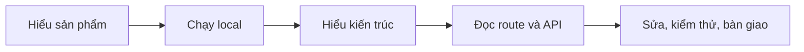

# Tài liệu V-Intern Frontend

Bộ tài liệu này đi cùng source `V-Intern FE`. Nếu bạn mới tiếp nhận, đọc theo lộ trình bên dưới thay vì mở từng file ngẫu nhiên.

> **Trạng thái tài liệu:** cập nhật 02/11/2026, theo `main` tại `063c3d5`.
> Kết quả kiểm chứng và giới hạn nằm trong [VERIFICATION](VERIFICATION.md).

## Lộ trình đọc

| Bạn cần làm gì? | Đọc theo thứ tự |
|---|---|
| Chạy thử sản phẩm | [README repo](../README.md) → [GETTING-STARTED](GETTING-STARTED.md) → [TROUBLESHOOTING](TROUBLESHOOTING.md) |
| Hiểu hệ thống trước khi sửa | [ARCHITECTURE](ARCHITECTURE.md) → [ROUTE-MAP](ROUTE-MAP.md) → [API-CONTRACTS](API-CONTRACTS.md) |
| Làm giao diện mới | [UI-SYSTEM](UI-SYSTEM.md) → [ARCHITECTURE](ARCHITECTURE.md#4-luồng-dữ-liệu) → [TESTING](TESTING.md) |
| Kiểm thử / nghiệm thu | [TESTING](TESTING.md) → [VERIFICATION](VERIFICATION.md) → [DEMO](DEMO.md) |
| Tiếp nhận bàn giao | [HANDOVER](HANDOVER.md) → [VERIFICATION](VERIFICATION.md) → [CONTRIBUTING](CONTRIBUTING.md) |
| Kiểm tra bảo mật | [SECURITY](SECURITY.md) → [API-CONTRACTS](API-CONTRACTS.md#3-lỗi-và-trạng-thái) |

## Tài liệu kỹ thuật

| Tài liệu | Trả lời câu hỏi |
|---|---|
| [GETTING-STARTED](GETTING-STARTED.md) | Cần cài gì, cấu hình nào, chạy lệnh nào, xác nhận đúng bản bằng cách nào? |
| [ARCHITECTURE](ARCHITECTURE.md) | Route, guard, shell, auth, data layer và lifecycle phối hợp ra sao? |
| [ROUTE-MAP](ROUTE-MAP.md) | URL nào dùng page/component nào, thuộc vai trò nào? |
| [API-CONTRACTS](API-CONTRACTS.md) | FE gọi BE theo hợp đồng nào, xử lý lỗi và pagination thế nào? |
| [UI-SYSTEM](UI-SYSTEM.md) | Token, utility notebook, icon, component và quy tắc accessibility |
| [TESTING](TESTING.md) | Unit, browser, live harness và các gate CI |
| [SECURITY](SECURITY.md) | Phiên đăng nhập, phân quyền, XSS, secret và audit dependency |
| [CONTRIBUTING](CONTRIBUTING.md) | Quy trình nhánh, commit, PR và quality gate |
| [HANDOVER](HANDOVER.md) | Checklist tiếp nhận, việc còn mở và giới hạn đã biết |
| [TROUBLESHOOTING](TROUBLESHOOTING.md) | Chẩn đoán theo triệu chứng thay vì đoán |
| [VERIFICATION](VERIFICATION.md) | Bằng chứng nào đã có, đo ở đâu, còn thiếu gì? |
| [DEMO](DEMO.md) | Kịch bản demo ngắn và kịch bản chi tiết trước hội đồng |

## Tài liệu nghiệp vụ

| Nhóm | Tài liệu |
|---|---|
| Tuyển dụng | [CAREER-ROLES](CAREER-ROLES.md) · [CV-AND-INTERVIEW-SCHEDULING](CV-AND-INTERVIEW-SCHEDULING.md) · [SCHEDULED-INTERVIEWS](SCHEDULED-INTERVIEWS.md) · [TEMPORARY-CREDENTIAL-RECOVERY](TEMPORARY-CREDENTIAL-RECOVERY.md) |
| Dự án và tri thức | [MINI-PROJECTS](MINI-PROJECTS.md) · [KNOWLEDGE-LIBRARY](KNOWLEDGE-LIBRARY.md) |
| Làm việc và kết quả | [PARTICIPATION](PARTICIPATION.md) · [REPLACEMENT](REPLACEMENT.md) |
| GitHub | [GITHUB-INVITATIONS](GITHUB-INVITATIONS.md) · [REPOSITORY-ACCESS-RECOVERY](REPOSITORY-ACCESS-RECOVERY.md) |

## Lịch sử và bằng chứng

- [`reports/`](reports/) — báo cáo nghiệm thu theo giai đoạn, kèm JSON/ảnh.
- [`archive/`](archive/) — tài liệu trước đây, có thể mô tả chính sách cũ.
- [`design/`](design/) — ghi chú thiết kế và audit giao diện theo đợt.
- [`testing/`](testing/) — mô tả gate full-stack.

Các tài liệu ngày/tháng trong tên file là **bản chụp lịch sử**. Không sửa số liệu cũ để trông đồng bộ với hiện tại; hãy tạo mốc mới trong [VERIFICATION](VERIFICATION.md).

## Quy ước viết tài liệu

1. **Tiếng Việt**, câu ngắn, giải thích khái niệm trước khi dùng thuật ngữ.
2. **Liên kết tương đối** trong repo; không dùng đường dẫn tuyệt đối trên máy cá nhân.
3. **Không đưa secret** (mật khẩu, token, `.env`) vào tài liệu, ảnh hay log.
4. **Ghi rõ phạm vi**: đã kiểm route nào, viewport nào, commit nào, còn thiếu gì.
5. **Không trộn số liệu** từ các lần chạy hoặc các nhánh khác nhau.
6. Khi API đổi, cập nhật [API-CONTRACTS](API-CONTRACTS.md), parser/adapter và test trong cùng PR.
