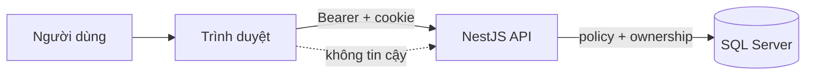

# Bảo mật Frontend

Frontend không phải ranh giới tin cậy cuối cùng. Mọi kiểm tra quyền, trạng thái, điểm và dữ liệu nhạy cảm vẫn phải được Backend xác minh. Tài liệu này mô tả những gì FE **phải** làm để không tạo lỗ hổng hoặc làm sai tín hiệu bảo mật.

## 1. Mô hình tin cậy

| Thành phần | Tin cậy? | Hệ quả |
|---|---|---|
| Input người dùng | Không | Validate ở form **và** BE; không render HTML thô |
| Response API | Có cấu trúc, không hoàn toàn | Adapter kiểm schema; không tin field tự do |
| Local state | Không | Có thể bị sửa bằng DevTools; không dùng để cấp quyền |
| `NEXT_PUBLIC_*` | Công khai | Không chứa secret |
| Cookie refresh | HttpOnly | JS không đọc; không log/không xuất ra UI |
| Access token | Trong memory | Không lưu localStorage/URL/BroadcastChannel |

## 2. Phiên đăng nhập

- Access token chỉ giữ trong bộ nhớ; mất khi reload và được lấy lại bằng refresh cookie.
- Refresh dùng **single-flight**: nhiều request 401 chia sẻ một lần refresh.
- `BroadcastChannel` chỉ phát sự kiện logout/refresh giữa tab; **không** truyền token, profile hay dữ liệu nhạy cảm.
- 401 → xóa phiên và về login. 403 → từ chối quyền, không tự nâng quyền.
- Refresh bị throttle/lỗi mạng **không** được coi là logout; cookie invalid/revoked thì fail closed.
- Đăng xuất phải xóa state trong memory và cookie phía BE; không chỉ điều hướng về `/login`.

## 3. Phân quyền

Hai lớp khác nhau:

| Lớp | Ví dụ | Vai trò |
|---|---|---|
| Hiển thị | `Can("sessions.update")`, ẩn nút | UX; tránh thao tác chắc chắn bị từ chối |
| Thực thi | Guard + service + ownership ở BE | Bảo mật thật |

Quy tắc:

- Không coi việc ẩn nút là bảo mật.
- Không gửi `internId`/`ownerId` để đọc dữ liệu người khác; API `own` lấy principal từ token.
- Giảng viên có permission vẫn chỉ thao tác trong project/session được giao.
- Route guard chỉ điều hướng; deep link vẫn phải được BE kiểm tra.
- Khi nhận 403, không thử lại bằng cách đổi role/URL hoặc bỏ qua UI.

## 4. XSS và render nội dung

- Không dùng `dangerouslySetInnerHTML` với dữ liệu người dùng/AI/GitHub.
- Nếu buộc phải render HTML từ nguồn tin cậy, phải sanitize bằng thư viện đã duyệt và có test.
- Link ngoài (GitHub, tài liệu) phải kiểm scheme `https:`; không mở `javascript:`/`data:`.
- Không đưa `target="_blank"` mà thiếu `rel="noopener noreferrer"`.
- Nội dung AI luôn là **đề xuất**, không render như HTML/authority.
- Tên file, commit message, PR title, lỗi provider đều là dữ liệu không tin cậy.

## 5. CSRF, CORS và cookie

- API dùng Bearer cho request nghiệp vụ; refresh cookie là HttpOnly.
- CORS phải allowlist origin chính xác, có credentials; không wildcard.
- Không tự gửi cookie sang domain khác.
- Khi đổi domain/port FE, cập nhật `CORS_ORIGINS`/`FRONTEND_ORIGIN` ở BE và kiểm tra lại login/refresh.
- Không lưu access token trong cookie do JS đọc được.

## 6. Secret và cấu hình

| Không được làm | Làm thay thế |
|---|---|
| Commit `.env`/`.env.local` | Dùng `.env.example`, cấu hình tại máy |
| Đặt token trong `NEXT_PUBLIC_*` | Giữ secret ở BE |
| Log token/cookie/profile nhạy cảm | Log mã lỗi, traceId, không log payload |
| Chụp màn hình có mật khẩu/token | Che hoặc dùng tài khoản demo riêng |
| Đưa `manual-runtime/private` lên GitHub | Giữ ngoài repo, backup theo quy trình riêng |

`NEXT_PUBLIC_*` được nhúng vào bundle và **ai cũng đọc được**. Chỉ dùng cho URL/cờ công khai.

## 7. GitHub và OAuth

- Admin cấu hình tài khoản tạo repo qua `POST /github/repository-account`; body **không** chứa password/token.
- OAuth Admin xin `read:user public_repo`; giảng viên/sinh viên chỉ `read:user`.
- Callback phải trùng tuyệt đối với OAuth App, gồm scheme/host/port.
- Không log authorization code, access token hoặc refresh token.
- Danh tính GitHub ghép theo numeric ID, không đoán username từ email.
- Khi scope thiếu hoặc danh tính đổi, hiển thị lỗi rõ; không tự mở rộng quyền.

## 8. Tải file và nội dung người dùng

- PDF/XLSX/ảnh tải về phải kiểm content-type và tên file; không render trực tiếp HTML.
- Preview PDF/ảnh dùng URL do BE cấp, không nhận URL tùy ý từ query nếu chưa allowlist.
- Upload (nếu có) giới hạn loại/kích thước ở cả FE và BE; không tin MIME từ client.
- Không mở file người dùng tải lên trong cùng origin với quyền cao.

## 9. Dependency và supply chain

- CI chặn `npm audit --omit=dev --audit-level=high`.
- Audit toàn cây dev được review riêng; không tuyên bố “sạch tuyệt đối” nếu còn finding chưa có bản vá.
- Không thêm package không rõ nguồn để xử lý một lỗi nhỏ.
- Khi nâng Next/React, đọc changelog và chạy lại toàn bộ gate; không chỉ sửa version trong `package.json`.
- Giữ `package-lock.json`; CI dùng `npm ci`.

## 10. Log, telemetry và dữ liệu cá nhân

- Không log access token, refresh cookie, mật khẩu, CV raw, câu trả lời phỏng vấn nguyên văn.
- Trace/analytics chỉ gửi mã lỗi, thời lượng, ID tham chiếu; không gửi PII.
- Ảnh/log bằng chứng phải che email, token, dữ liệu của người khác.
- Chỉ thu thập dữ liệu cần cho tính năng; không thêm tracking bên thứ ba khi chưa được duyệt.

## 11. Checklist review bảo mật

- [ ] Route mới có guard đúng vai trò và BE kiểm tra lại?
- [ ] Hành động nhạy cảm có confirm/disable khi đang gửi?
- [ ] Không render HTML/URL không tin cậy.
- [ ] Không lưu token vào storage/URL/log.
- [ ] 401/403/409/429 xử lý đúng, không retry vô hạn.
- [ ] Form validate và giữ draft khi lỗi.
- [ ] Dependency/audit không có high/critical chưa xử lý.
- [ ] Ảnh/log không chứa secret/PII.

## 12. Khi phát hiện sự cố

1. Dừng việc chia sẻ log/ảnh có dữ liệu nhạy cảm.
2. Thu hẹp phạm vi: route, tài khoản, thời điểm, commit.
3. Thông báo người phụ trách; không tự “thử nghiệm” trên DB chính.
4. Nếu token/lộ secret: thu hồi/rotate qua kênh riêng, không ghi giá trị vào issue.
5. Ghi lại nguyên nhân, cách sửa và test hồi quy.

Xem thêm [API-CONTRACTS](API-CONTRACTS.md#3-lỗi-và-trạng-thái) và [CONTRIBUTING](CONTRIBUTING.md).
