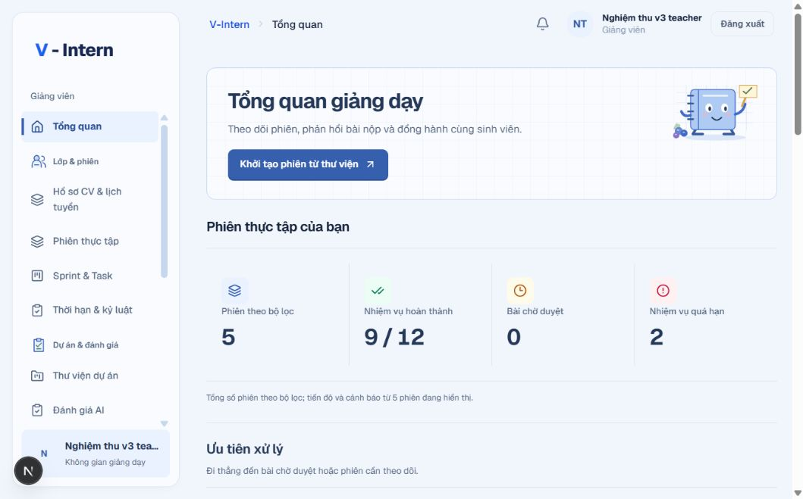
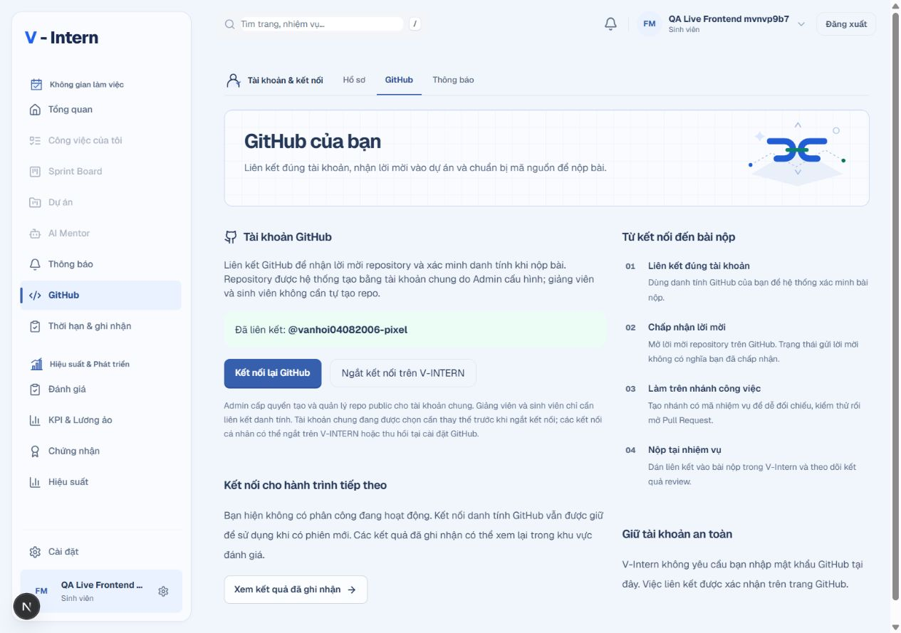

# Giao diện sổ tay V-Intern: nền tảng đã triển khai

Đây là lát triển khai dùng chung cho Admin, giảng viên và sinh viên. Tại thời điểm báo cáo, inventory có 78 route; source ngày 29/10/2026 hiện có 82 page source. **Lát nền này chưa phải nghiệm thu từng route hoặc hoàn tất redesign từng luồng.** Phần nghiệp vụ dùng bộ kiểm chứng riêng ở [checkpoint dịch vụ thật](../ACCEPTANCE-CHECKPOINT-20261026.md).

## Đã thay đổi những gì?

Nền cũ có nhiều thẻ tím, khung bo lớn và các chỉ số được đóng hộp giống nhau. Lát này chuyển sang nền giấy sáng, xanh việt quất, nét kẻ nhẹ ở vùng tiêu đề và nhân vật sổ tay riêng. Form, bảng và nội dung dài dùng nền đọc rõ; ô ly không đặt phía sau dữ liệu cần đọc kỹ.

- Shell của cả ba vai dùng chung token, active navigation có vạch bên trái, trạng thái focus và mật độ điều hướng.
- Thanh chuyển khu vực có biểu tượng nhóm và gạch dưới trang hiện tại. Menu, liên kết bị khóa theo vòng đời và quyền truy cập được giữ.
- KPI tổng quan được trình bày bằng chữ số và đường chia. Section và form dùng khoảng trắng; dự án và thẻ Kanban vẫn là các đối tượng độc lập.
- Tiêu đề học tập dùng minh họa sổ tay học/hướng dẫn thay ảnh robot cũ. Không thay trang chủ `/`.
- Danh sách task của phiên giữ điểm AI, quyết định giảng viên, thời điểm, SHA và link PR ở ngoài. Nhận xét dài mở bằng “Đọc nhận xét và bằng chứng”, hỗ trợ Enter và bàn phím; nội dung vẫn được giữ đầy đủ.
- Trạng thái GitHub sau khi hết phân công đã được kiểm lại trên UI: hướng dẫn hành trình tiếp theo, không quay về câu chữ chờ phân công lần đầu hoặc tự suy mọi lịch sử là hoàn thành.

## Token và quy cách

| Lớp | Ví dụ hiện dùng | Mục đích |
|---|---|---|
| Màu gốc | Blue `#365FAE`, hover `#294E92`, mực `#253858`, giấy `#FAFBFE` | Nhận diện thống nhất |
| Ngữ nghĩa | `--ws-primary`, `--ws-muted`, `--ws-success`, `--ws-warning`, `--ws-danger` | Phân biệt hành động, nội dung phụ và trạng thái |
| Component | Radius 4/6/8/12 px, sidebar 16 px, input/button 8 px | Giảm cảm giác mọi thành phần đều là thẻ bo lớn |
| Khoảng cách | 4/8/12/16/24/32/40/48 px, kế thừa workspace tokens | Thoáng giữa section, gọn bên trong đối tượng |
| Chuyển động | Tiêu đề 220 ms, mở nhận xét 180 ms, nút nhấn dịch 1 px | Phản hồi ngắn; tắt theo reduced motion |

Các token nằm trong `src/components/workspace/aurora.css`, sửa ngay lớp theme đang dùng thay vì chồng thêm stylesheet toàn cục. Tên lớp Aurora được giữ để các layout hiện hữu tiếp tục hoạt động. Selector được giới hạn trong workspace; không thay màu thương hiệu của trang chủ bằng biến toàn cục.

## Bộ biểu tượng và hình ảnh

| Asset | Source | Trạng thái sử dụng |
|---|---|---|
| 12 biểu tượng: công việc, phân tích, tài khoản, dự án, Mentor, chứng nhận, lịch tuyển, thông báo, review, vận hành, thư viện, đội nhóm | `workspace/learning-icon.tsx` | Thư viện SVG đã có; các nhóm điều hướng và thanh khu vực đã sử dụng một phần. Không nói tất cả icon chức năng đã được thay |
| Sổ tay học tập, sổ tay hướng dẫn | `workspace/notebook-companion.tsx` | Dùng ở tiêu đề học tập/hướng dẫn; SVG tự vẽ, không sao chép mascot từ mẫu tham khảo |
| Dự án, kết nối, kết quả | `workspace/workspace-artwork.tsx` | Kế thừa minh họa SVG hiện có, cùng bộ màu; không phải dữ liệu hoặc thành tích |
| Icon thao tác quen thuộc | Lucide đang có | Giữ nghĩa của đóng, mở, tìm kiếm, GitHub và hành động nghiệp vụ |
| Hình chưa tạo | Lịch phỏng vấn, CV, chờ/lỗi/rỗng theo từng luồng | Còn trong [manifest](../../tasks/ui-route-asset-manifest.md), chưa ghi đã hoàn thành |

SVG trang trí có `aria-hidden`, không chiếm focus. Nhãn chữ vẫn giải thích hành động và trạng thái. Không thêm XP, streak, số liệu hoặc thành tích giả.

## Kiểm chứng của lát này

Code: **4808210**. Local: **108 file / 651 test đạt**, lint file đổi, typecheck và production build đạt. Build đầu gặp lỗi khởi tạo PostCSS worker; giữ log, dừng đúng hai web dự án, bảo toàn `.next` dưới `.runtime` và build lại bằng cache sạch với cùng compiler. Không bỏ gate, đổi compiler hoặc sửa timeout để đạt.

| Kiểm trên trình duyệt | Kết quả và giới hạn |
|---|---|
| 15 lượt responsive | Thông báo giảng viên, GitHub sinh viên, tổng quan Admin × 390/768/1024/1280/1440 px: không tràn ngang. Đây là ba trang mẫu cho nền chung, không phải nghiệm thu 82 page source |
| Drawer sinh viên | Mở, Escape, trả focus đúng nút menu; điều hướng GitHub và đóng drawer |
| Drawer Admin | Mở, Escape, trả focus đúng nút menu; ProductShell dùng chung với giảng viên |
| Nhận xét task giảng viên | Enter mở phần AI/giảng viên riêng; điểm và PR/SHA vẫn hiện khi thu gọn |
| GitHub sau lịch sử | Login sinh viên qua form, mở GitHub từ drawer; thấy “Kết nối cho hành trình tiếp theo” |
| Biểu đồ và điều hướng | Bộ kiểm tập trung 32 test đạt; giữ legend bằng bàn phím, scope và liên kết theo vai |

Nguồn máy đọc: [notebook-ui-20261026.json](../reports/notebook-ui-20261026.json). Ảnh kiểm đầy đủ và log ở workspace `.runtime` / `manual-runtime/final-integration-20261025/notebook-ui`. Hai ảnh dưới là giao diện đang chạy với dữ liệu QA:

## Phần tiếp theo

1. Thu gọn thông báo dài, bổ sung phản hồi khi đánh dấu đã đọc và thay tùy chọn; giữ pending/error và tránh thao tác trùng.
2. Trau chuốt riêng các màn công việc, nộp bài, review, tuyển dụng, báo cáo và thư viện thay vì chỉ dựa vào theme chung.
3. Mở rộng kiểm thử responsive, trạng thái rỗng/lỗi/thành công và bàn phím tới từng route, từng dialog trong inventory.
4. Public/onboarding có layout riêng, chưa được coi đã nhận đầy đủ redesign này. Trang chủ giữ nguyên.
