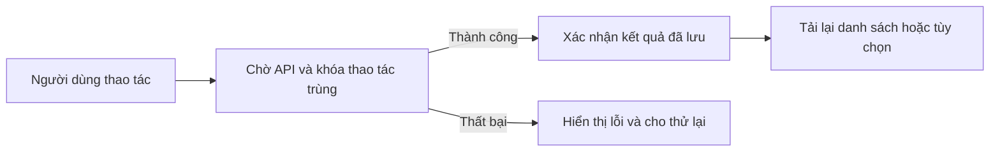

# Thông báo: đọc, xử lý và đổi tùy chọn

Tab Thông báo của sinh viên, giảng viên và Admin dùng chung một cách trình bày và phản hồi. Lát này tiếp nối [nền giao diện sổ tay](NOTEBOOK-FOUNDATION-20261026.md). Code triển khai: **603ee3f**.

## Trải nghiệm đã hoàn thiện

Danh sách được chia theo ngày. Thông báo chưa đọc có dấu nhận diện và nhãn chữ; thông báo đã đọc có nhãn “Đã đọc”. Nội dung dài hiển thị gọn ba dòng, có nút “Đọc đầy đủ” và “Thu gọn”. Mở nội dung dài chỉ thay cách hiển thị; thao tác đó không tự đánh dấu đã đọc.

Trên màn hình rộng, danh sách là vùng chính và tùy chọn nhận thông báo ở cột bên cạnh. Trên màn hình nhỏ, hai phần xếp dọc. Các tùy chọn dùng dòng thông tin và đường chia thay cho nhiều thẻ lồng nhau.

| Thao tác | Trong lúc chờ | Sau khi hệ thống xác nhận |
|---|---|---|
| Đánh dấu một thông báo | Khóa thao tác cập nhật trùng | “Đã đánh dấu thông báo là đã đọc.”; dòng chuyển sang đã đọc |
| Đánh dấu tất cả | Nút hiển thị đang cập nhật | Hiển thị đúng số bản ghi API đã cập nhật |
| Không còn thông báo chưa đọc | Vẫn đối chiếu qua API | “Không có thông báo chưa đọc cần cập nhật.” |
| Bật/tắt một loại | Checkbox tạm khóa trong lúc lưu | Xác nhận đúng tên loại và trạng thái bật/tắt |
| Yêu cầu thất bại | Kết thúc trạng thái chờ | Hiển thị lỗi an toàn, giữ dữ liệu đã lưu; không giữ thông báo thành công cũ |

## Cách tự trải nghiệm

1. Đăng nhập đúng vai, mở Thông báo từ thanh điều hướng hoặc biểu tượng chuông.
2. Bật “Chỉ hiện chưa đọc”, rồi bỏ lọc để đối chiếu danh sách. Bộ lọc không thay trạng thái đọc.
3. Với nội dung dài, dùng “Đọc đầy đủ”. Có thể Tab tới nút và nhấn Enter; Enter lần nữa thu gọn. Nhãn đọc vẫn giữ nguyên.
4. Trên dữ liệu QA, chọn “Đánh dấu đã đọc”. Chờ thông báo xác nhận và kiểm lại dòng vừa xử lý. Khi bật lọc chưa đọc, dòng đã đọc không còn thuộc kết quả lọc.
5. Thử bật/tắt một tùy chọn. Chờ xác nhận rồi tải lại để kiểm giá trị đã lưu. Khi nghiệm thu, trả tùy chọn về giá trị ban đầu.
6. Ở trang không có thông báo chưa đọc, “Đánh dấu tất cả” phải báo không có bản ghi cần cập nhật, thay vì báo một con số giả.

## Kiểm chứng có nguồn

| Nhóm | Kết quả |
|---|---|
| Regression toàn FE | **109 file / 660 test đạt** |
| Kiểm thử riêng cho thông báo | **9 test đạt**: ba vai; chờ xác nhận và chống bấm trùng; cập nhật 0; xóa thành công cũ khi lỗi; mở bằng bàn phím không đánh dấu đọc; lưu tùy chọn; phục hồi giá trị sau lỗi |
| Lint và typecheck | Đạt cho code thay đổi |
| Production build | Đạt với compiler hiện tại; không đổi gate hoặc timeout |
| UI Admin thật | Trang rỗng trả số cập nhật 0; tắt/bật lại thông báo nhiệm vụ, có hai xác nhận và khôi phục giá trị ban đầu |
| UI giảng viên thật | Enter mở/thu gọn nội dung; đánh dấu một thông báo QA, nhận xác nhận và nhãn đã đọc |
| UI sinh viên thật | Đánh dấu lời mời GitHub QA, lọc chưa đọc không chứa nhãn đã đọc; bỏ lọc trở lại |
| Responsive | **15 lượt**: ba tab thông báo × 390/768/1024/1280/1440 px; kích thước đo thực khớp kích thước yêu cầu; không tràn ngang |

Nguồn đầy đủ: [notifications-ui-20261026.json](../reports/notifications-ui-20261026.json). Một lượt đo viewport ban đầu chưa kịp đổi kích thước được giữ trong bằng chứng riêng và loại khỏi các lượt đã đạt. Ma trận đã chạy lại có kiểm kích thước thực trước khi ghi nhận.

Unit local chạy một worker để phù hợp RAM máy; toàn bộ test và timeout giữ nguyên. Cấu hình CI không thay đổi. CI và số liệu của nền UI trước đó được giữ trong report riêng, không gán receipt cũ cho code mới.

## Dành cho người bảo trì

| Phần | Source |
|---|---|
| Danh sách, lọc, phân trang, đánh dấu đọc và lưu tùy chọn | `src/components/product/outcomes.tsx`, hàm `Notifications` |
| Mở/thu gọn chữ, liên kết `aria-controls` | `src/components/product/notification-text.tsx` |
| Tiêu đề thống nhất giữa ba vai | `src/components/intern/student-outcome-heading.tsx` |
| Trình bày dòng, trạng thái chưa đọc, nội dung và tùy chọn | `src/components/workspace/aurora.css` |
| Regression | `src/components/product/__tests__/notifications-feedback.test.tsx` |

Các endpoint và parser được giữ: danh sách `/notifications`, đánh dấu một dòng `/notifications/:id/read`, đánh dấu tất cả `/notifications/read-all`, và `/notifications/preferences`. Link trong thông báo tiếp tục qua bộ kiểm đường dẫn theo vai hiện có; nội dung được render như văn bản.

Lát này không thay backend, dữ liệu nghiệp vụ hoặc trạng thái phỏng vấn. Đây là nghiệm thu tab Thông báo của ba vai; kiểm tra chi tiết các tab khác tiếp tục theo [plan UI](../../tasks/learning-identity.md).
