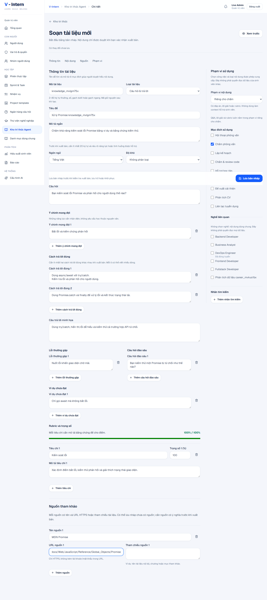
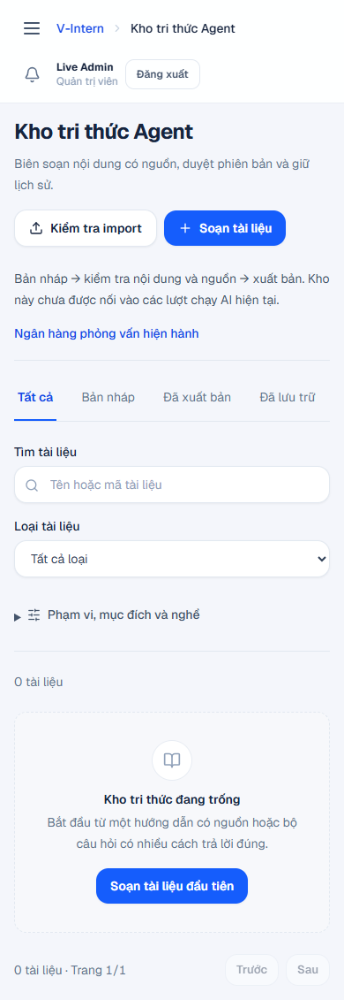

# K03 — giao diện kho tri thức · 24/10/2026

**Đã đạt local + CI và kích hoạt runtime chính.** Phạm vi: ba route Admin cho danh sách, tạo mới và biên soạn tài liệu. Chưa kết luận retrieval K04 hoặc các Agent đã dùng kho.

Code UI: `17f4370c5475358103fca61454fcae55bae1614b`, cùng adapter/trình soạn `276e807` và `6604fcf`. BE tương thích: `bf3118693c782c145a87d4348212344396ce3526`. [Hướng dẫn thao tác và bàn giao](../KNOWLEDGE-LIBRARY.md).

## Kết quả có nguồn

| Kiểm tra | Kết quả |
|---|---|
| FE Vitest | 88 file / 579 test đạt; 29 test mới so với nền 550 |
| Node contracts | 22/22 đạt, bảo toàn 14 bước nghiệp vụ và bổ sung bước knowledge |
| Lint / typecheck | Đạt |
| Build riêng | Next production build đạt, không ghi đè bản đang phục vụ cổng 3001 |
| Browser + Nest + SQL thật | 5 nhóm tình huống đạt; không intercept API |
| Responsive | 24 kiểm tra: list, QA editor, publication modal, import modal × 320/390/768/1024/1280/1440 px; không tràn ngang |
| Keyboard | Tab giữ focus trong dialog; Escape đóng và trả focus về nút mở |
| BE tương thích | 669 unit; 23 SQL/HTTP. [CI backend](https://github.com/vanhoi04082006-pixel/V-Intern-BE/actions/runs/40021504108) và [acceptance](https://github.com/vanhoi04082006-pixel/V-Intern-BE/actions/runs/40021504546) đạt |
| FE CI `70d5e97` | [Quality](https://github.com/vanhoi04082006-pixel/V-Intern-FE/actions/runs/40025607601) và [full-stack](https://github.com/vanhoi04082006-pixel/V-Intern-FE/actions/runs/40025607650) đạt; 14/14 bước cũ, career và knowledge đều thành công; hoàn tất full-stack 23/10 lúc 21:27:31 UTC, tức 24/10 04:27:31 Asia/Bangkok |

Log local: `workspace/manual-runtime/knowledge-library-20261024/{fe-unit,fe-node,fe-lint,fe-types,fe-build,browser}.log`. Bản kết quả browser và ảnh nằm trong `phase7-evidence/knowledge-library/` dưới cùng thư mục runtime; dữ liệu thử chỉ ở SQL Server 2019 dùng riêng. [Kết quả được lưu cùng tài liệu](../knowledge-assets/result.json).

## Đã kiểm hành vi nào?

1. Admin tạo Q&A nhiều đáp án, giữ xuống dòng và nguồn HTTPS; rubric 100%; xuất bản tạo revision mới.
2. Sửa published về draft. Một thay đổi đồng thời qua API thật làm lần lưu từ UI nhận 409; nội dung đang soạn vẫn giữ. Đối chiếu không tự ghi đè; chỉ thay sau lựa chọn rõ ràng.
3. Archive, đọc snapshot published cũ rồi khôi phục thành draft mới. Có sáu revision; hash bản published cũ không đổi.
4. Tìm theo mã, lọc published/draft; upload JSON và dry-run. SQL đếm trước/sau chứng minh không thêm revision bởi import.
5. Một guide còn thiếu bị chặn xuất bản. Không gọi AI/provider trong tình huống authoring này.

Unit bổ sung kiểm draft malformed được giữ, loại tài liệu đổi có xác nhận, quyền read/manage/publish tách biệt, publisher không cần manage, dữ liệu xung đột không mất, khôi phục cần xác nhận, readiness sai version/hash bị chặn và preview không thực thi HTML/URL nguy hiểm.

## Thay đổi giao diện và nguyên nhân

Danh sách dùng hàng compact, tab trạng thái, filter nâng cao và pager; không tải body Q&A vào collection. Trình soạn có section điều hướng, cột scope riêng, nguồn và rubric có cấu trúc. Preview/history dùng native dialog và focus management hiện có. Không thêm package, không thay homepage hoặc business logic sinh viên/giảng viên.

Browser phát hiện nhóm nút PageTitle tràn 320 px. Sửa giới hạn chiều rộng nhóm action và cho phép wrap; chạy lại đủ 24 kiểm tra đạt. Trạng thái archive dùng đúng tone trung tính của component chung.

## Giới hạn cần hiểu

- Không có bulk import mutation, autosave, rich-text editor hoặc tự tải nguồn ngoài.
- Cảnh báo chưa lưu bảo vệ refresh/đóng tab và liên kết quay về kho trong editor; chưa chặn mọi điều hướng SPA/sidebar hoặc nút Back. Hướng dẫn yêu cầu lưu trước khi rời bằng các lối đó.
- Ảnh và dữ liệu nghiệm thu là fixture trong DB riêng; không phải nội dung chuyên môn đã duyệt để đưa vào Agent.
- K04 sẽ làm retrieval có scope, citation/version và chống lộ đáp án. LangChain/LangSmith, CV, mail và thư viện dự án thuộc các hạng mục tiếp theo.

## Bản local và dữ liệu được giữ

Đã build source cuối vào `.next` sau khi dừng đúng tiến trình FE, giữ bản build trước trong workspace để có đường lui và restart các API/FE do dự án sở hữu. Không migration mới hoặc reset/seed. Lần poll đầu của launcher kết thúc trước khi SQL kết nối xong; các API thử lại kết nối rồi khởi động thành công. Readiness sau đó xác nhận 8080/8081 healthy và 10 thao tác knowledge trên mỗi API.

`native-before.json` / `native-after.json` đối chiếu số user/hồ sơ/phỏng vấn/câu trả lời/câu hỏi/phân công/template/chứng nhận/lượt phỏng vấn/kho và revision: không đổi trên cả hai DB. MDF/LDF được xác nhận nằm trong workspace. Bảy tài khoản gốc/demo/defense đăng nhập và đọc catalog đúng quyền, không tiêu hao lượt. `native-browser.json` xác nhận Admin thật mở list/editor/preview trên cổng 3001, sáu độ rộng không tràn và không mutation/page error. Readiness bắt đầu 23/10 21:32:29 UTC; browser hoàn tất sau đó. Log đều ở thư mục evidence cùng ngày.

## Ảnh kiểm chứng

Trình soạn Q&A với dữ liệu thử thực tế:

Danh sách ở mobile (trạng thái kho trống trước khi tạo fixture):

